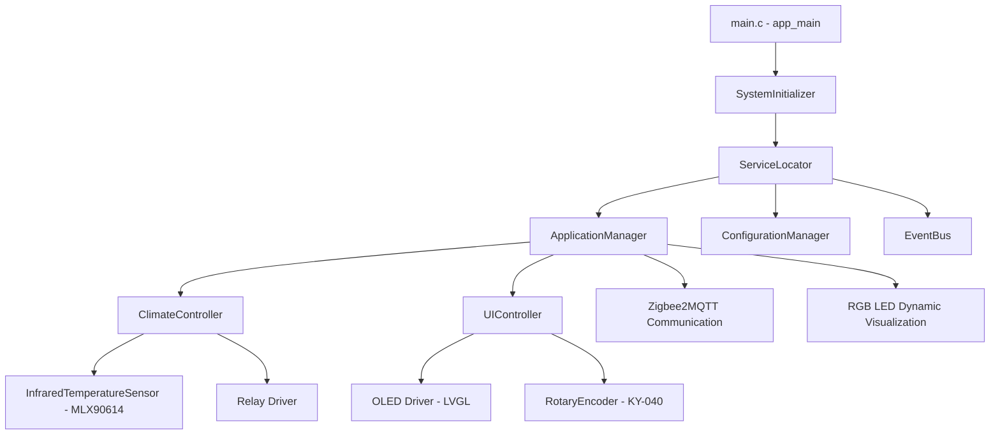
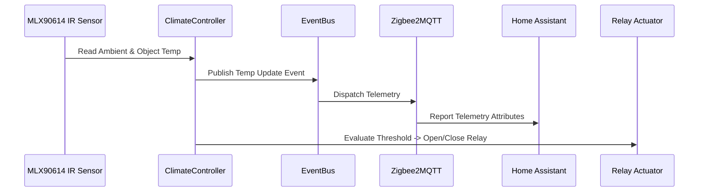

Fan revizyonunun canlı helper komutları: `read-fan-sources` 18 attribute için transaction-correlated raw ZCL snapshot alır; `verify-fan-sources` signed delta ve üç RAM input'u checked finally restorasyonla sınar. Serial `verify_fan_sources.py --port ... --output ... --stale-window` gerçek 5 dakika stale/recovery ve iki fresh reboot kullanır; mutable testlerden önce baseline kaydedilir. Aynı portta başka owner çalıştırılmaz.

Native runner compile aşamasının warning/error çıktısını `test/Infrastructure/build_diagnostics.mjs` ile reddeder; runtime kasıtlı hata injection loglarını build diagnostic saymaz. `ZIGBEE_ATTRIBUTE_QUEUE_CAPACITY=96` settings+13 fan diagnostic burst için bounded statik kuyruğun sınırıdır; önceki64'e göre768 byte ek storage. Queue admission teslim kanıtı değildir. OLED fark başlığı altında desteklenen °C birimi gösterilir.

# Dil/font altyapısı — entegrasyon devam ediyor

CLI `LANGUAGE`, `LANGUAGE LIST`, `LANGUAGE SET tr|en` kaynakta kayıtlıdır; checked ConfigurationManager.UpdateFields persist=true sonrası owner aktif kataloğu aynı mutex sahipliğinde değiştirir. Mevcut olmayan katalog/kayıt hatası başarısızdır; saklanan eski locale kaldırılmışsa Türkçe fallback kullanılır ve kod silinmez. Bu komutun çıktısı çevrilmiştir; tüm diğer CLI/OLED metinleri hâlâ bekler. LANGUAGE anında seçim, uyuyan ekranın korunması, gerçek restart kalıcılığı ve finally restorasyonu `test/Core/Localization/diagnostic/verify_language.py --port ... --output ...` ile kabul edildi. Parser testi `test/Core/Localization/test_language_live.py` içindedir.

Format üreticisi LOC_PRINTF kaynak referanslarını da doğrular; literal reference compiler tür denetimini korur. Kataloglar NFC'ye normalize edilir. PlatformIO ön kontrolü katalog/font/üretici ve ilgili kaynak referanslarını fingerprint ederek stale generated-header kullanımını önler; yalnız ortam CMakeCache.txt invalidation alır. `test/Infrastructure/test_platformio_manifest.py` ve katalog helper negatif testleri bu yolu doğrular.

`Localization_Snapshot` response/frame için sabit flash katalog pointer'ı verir. `Localization_Text` üretilen enum ile, `Localization_TextKey` sorted semantic key tablosunda binary search ile okur; key bulunamazsa NULL döner. Katalog tablosu ve metinler firmware ömrü boyunca geçerli kalır. Snapshot sahibi, global dil değişse de cevabını aynı katalogla tamamlayabilir.

`resources/translations/en.json` ve `tr.json` başlangıç ürün kataloglarıdır; bütün OLED/CLI metinlerinin göçü henüz bitmedi. `tools/generate_translations.py <catalog-directory> <output-directory>` katalogları keşfedip doğrular ve build dizinine değişmez C tablo/header üretir. `include/src/Core/Localization` bu tablolar için atomik seçim ve response/frame snapshot erişimi sağlar. `tools/product_resources.cmake` gerçek configure aşamasında JSON keşfi/bağımlılık ve build-local katalog/font üretimini bağlar; ESP-IDF erken script-mode taramasını atlar. Node bağımlılıkları `npm ci` ile kurulmalıdır. ConfigurationManager'ın yedinci `localization` bloğu locale kodunu8 byte ve sürümü4 byte olarak saklar; eski SystemBaseConfigs20 byte yerleşimi korunur. Defaults/load/save/field allowlist/VerifyDefaults ortak yollarına bağlıdır. Ürün girişleri ve aktif katalog uygulaması henüz bağlı değildir. `Localization_Apply` kendi başına ayar kaydetmez; checked configuration uygulamasından sonra çağrılmalıdır.

`tools/generate_oled_fonts.mjs <output-directory>` sabit Noto Sans SemiBold v2.015/SHA-256 ve lv_font_conv1.5.3 ile geniş Latin/Yunanca/Kiril tabanını 10/14/20px 1bpp LVGL fontlara üretir. Üretim ekranları henüz bu fontlara geçirilmedi; geniş satır yüksekliğine göre yerleşim doğrulanacak. FontAwesome simgeleri ayrı tutulur. Odaklı doğrulama: `node --test test/Hardware/OLED/test_font_generation.mjs` ve `.venv/Scripts/python.exe test/Core/Localization/test_catalog_generation.py`. Son komut gerçek C seçiciyi de host gcc ile uyarıları hata sayarak derler; ESP32 veya fiziksel çizim kanıtı değildir.

# Fan kaynak revizyonu — güncel arayüzler

`FanCommands.h` bütün OLED/CLI/Zigbee fan ayarlarını ortak semantik dispatcher ile ConfigurationManager.UpdateFields üzerinden geçirir. `TemperatureSources.h` sabit üç RAM slotunu ve bağımsız nesne/ortam kaynaklarını çözer; `FanControl_Evaluate` kaynak donanımını bilmez. Slotlar gerçek restart'ta boş başlar, 5 dakika eskime ve dahili fallback/recovery kullanır. Delta nesne eksi ortamdır; signed −9…+9 ve +2/+1 varsayılanı 0.1 çözünürlükte saklanır, ZCL ölçüm/karar sınırları centidegree ile tutarlıdır. ControlConfigs V2 32 byte/version offset 28; V1 24 byte/version offset 20 explicit migration ile korunur ve tam validation sonrası commit edilir.

IClimateController yeni `SetExternalTemperature`, `ClearExternalTemperature`, `GetTemperatureSources`, `RequestFanAction`, `GetFanActionStatus` arayüzlerini sunar. Dış input NVS'ye gitmez; clear ayrı invalidation komutudur. CPU override configured mode'u değiştirmez. Röle yazımı Climate worker'da `Climate_SetRelayTarget` üzerinden checked yürür. Relay CLI ve ApplicationManager fan istekleri doğrudan GPIO/actuator yazmaz. Süreli diagnostic işlemler tek copied admission, elapsed worker deadline ve ayrı pending/active/result readback taşır; CPU/system-disabled/Stop bunları iptal eder. Worker kısa diagnostic deadline için mevcut wait'i kısaltır, bütün pozitif beklemeler en az bir tick'tir; yeni task oluşturulmaz.

`CLIMATE MODE OBJECT_SENSITIVE|AMBIENT_DELTA|ON|OFF`, `SOURCE OBJECT|AMBIENT 0..3`, `DELTA on off`, `EXTERNAL 1..3 value|CLEAR`, `SOURCES`, `ACTION`, mevcut `SET HIGH|LOW` ve `SAVE` komutları kullanılır. OLED dört fan modu, iki kaynak ve iki delta ayarını statik sıcaklık kategorisinde sunar; yeni enum ID'leri sona eklenmiştir. [Modül belgesi](src/Controllers/ClimateController/README.md) wire attribute tablosunu, semantics ve migration sınırlarını içerir. HA heartbeat örneği `tools/home-assistant/racool-external-temperature.yaml`; dashboard generator yeni kaynak kontrollerini ve diagnostikleri çözer.

Runtime external input'lar generic reversible settings verifier'dan çıkarılmıştır; dedicated snapshot/clear/restoration kabulü gerekir. Null MQTT external input açık invalidation; invalid ZCL ölçüm sentinel'i null olarak sunulur. Diğer özelliklerin meşru automatic isimleri korunur. Yeni TemperatureSources native suite manifest'e kayıtlıdır; bütün named cases, inventory ve warning-free production/target/restoration zorunludur.

# Ekran modu ve donma varsayılanı

`ZB ROUTERS` public SDK komşu/route/source-route tablolarının bounded snapshot'ını listeler; coordinator ve end-device'ları router filtresiyle gizlemez. Snapshot kopyalama SDK lease içinde, yazdırma dışında yapılır. Kapasiteler ZigbeeConfig.h içinde 64/64/32; eksik/taşan/hatalı tablo complete=0 ve başarısız komut sonucudur. Unknown IEEE adresi bounded eski discovery pool'uyla çözülür; tablo kaydı yok sayılmaz. Doğrudan çocuk ve yönlendirme kayıtları gerçek transit paket geçmişi/sayacı değildir. Firmware paket akışını gözlemlemeden bir komşuyu “RaCool üzerinden trafik kullandı” diye sunmaz.

OLED display_mode protokolü 1=Otomatik, 2=Daima Açık'tır. SystemConfigs_IsValidDisplayMode yeni NVS/CLI/Zigbee yazımlarında 0'ı reddeder; ConfigurationManager yalnız eski kayıt yüklemesinde 0'ı varsayılan 1'e taşır ve normal migration commit/rollback yolunu kullanır. Uyku ve reset sırasında panelin kapatılması ayrı çalışma eylemleridir; kaldırılan 0 ayarıyla karıştırılmaz. RGB donma varsayılanı DEFAULT_EXT_LED_TEMP_FREEZE=4.0f; kayıtlı kullanıcı değeri reset yapılmadan değiştirilmez.

# Test ağacı

Modül testleri src/ klasörlerini aynalar. Canlı yardımcılar ilgili modülün diagnostic/ dizininde, ortak mocks/support ve Integration dosyaları Infrastructure/ içinde bulunur. PlatformIO discovery için iki düz test_target_* giriş klasörü korunur; target_suites.json entry alanını gerçek case kaynağından ayrı kaydeder. check_test_inventory.mjs, check_test_layout.mjs denetimini de çağırır. Dizinin düzenli olması bütün modüllerin test kapsamının tamamlandığı anlamına gelmez. Komut ve geçerli helper yolları test/README.md ile AGENTS.md içinde günceldir.

# CODEBASE.md - RaCool Technical Architecture & Codebase Map

IZigbeeEndpoint.ConfigureReporting now returns esp_err_t, as do the common
reporting helpers. Missing descriptors and snapshot/SDK failures are observable;
disabled reporting preserves metadata failure even when stopping succeeds.
Reporting refresh retries transient errors on later timer turns, bounded by
ZIGBEE_REPORT_MAX_ATTEMPTS per request revision. Exhaustion remains a health
failure until a later successful refresh. New requests get a fresh budget.

RGBLED ApplySelectedMode is an asynchronous explicit mode-selection command:
it clears manual overrides even if the persisted mode is unchanged. Coalesced
settings refreshes preserve manual color and animation phase when only brightness
or unrelated configuration changes. SDK color callbacks validate descriptor width
and enqueue copied RGB values without waiting for the lifecycle lock. The OLED
selector cycles Temperature, Animation and Off. RGB worker state is a logical
target, not a physical LED edge. Target RGB acceptance additionally reads real
LEDC duty during transition and brightness changes. External HA brightness live
verification uses `node test/Communication/Zigbee/diagnostic/live_zigbee.mjs verify brightness` with
RACOOL_SERIAL_PORT; RACOOL_RGB_EXPECT_COLOR optionally checks manual color
preservation. Its parser suite is test/Hardware/RGBLED/test_rgb_brightness_evidence.mjs.

Module console registrars now return esp_err_t; SystemInitializer checks every
management/controller/core/hardware registration result before declaring startup
complete. Configuration/UI/Memory/Resource and Climate register both aliases with
first-error propagation. PowerManager registers before applying its SDK profile;
internal LED, RGB and ErrorHandler registrars register before worker creation.
Hardware-only compositions may omit the console for the latter three services;
production startup still requires their public CLI registration. Successful
partial entries remain console-owned and may be retried; registration is not an
atomic rollback. Independent s_registered flags no longer outlive a console reset.

IDebugConsole.RegisterModule retains its void callback contract. Startup and
runtime registration collect the first error from calls made by the owning task;
errors from other tasks do not poison that result. Runtime callback execution is
serialized by the existing lifecycle mutex, without setting the startup flag or
pausing the console worker. Nested registrations share the owner's error context;
self Start/Stop and foreign module mutation while a callback is captured are
rejected. Bounded Stop contention preserves transport/task ownership. Native
registration tests cover missing boundaries, every backend failure position and
retry; the target console case additionally blocks a real FreeRTOS registration
callback. Test status and limitations are recorded in DEV_VERIFICATION_REPORT.md.

> **Operational Purpose:**  
> This document provides a maintained navigation map of the **RaCool** codebase for AI coding agents and human developers. It defines module boundaries, system architectures, hardware abstraction APIs, cross-module dependencies, and verification workflows.

---

## 1. System Overview & Technical Stack

Zigbee descriptor factories create mandatory attributes. Initialize Thermostat SystemMode and Thermostat UI TemperatureDisplayMode through their factory configuration; adding them a second time fails registration. Startup propagates descriptor errors. Successful application startup calls BootAnimation_NotifyReady through an atomic readiness flag; splash completion alone does not certify service health or network readiness.

ZB RESTART performs an acknowledged owner Stop followed by Start without resetting network credentials. Rejoin is asynchronous and must be verified separately. test/Communication/Zigbee/diagnostic/verify_zigbee_lifecycle.py checks three real SDK cycles and unchanged reporting intervals; SDK runtime error logs invalidate otherwise-zero return codes. PM-enabled production/target configurations include tickless capability for the IDF MAC retention lifecycle, while every router CPU profile keeps automatic light_sleep_enable=false.

ZigbeeRadioBoundary preserves the first esp_ieee802154_enable/disable failure through narrow linker wrappers, because SDK 2.0.4 can discard those driver return values. The sole SDK owner resets the atomic result at each init/deinit boundary, after external leases have drained, and merges it into its startup/cleanup result. Wrappers neither alter driver returns nor allocate, log or take a mutex. Native driver/worker injection is separate from real SDK lifecycle acceptance.

I2CManager publishes atomic bus resource readiness after successful SDK creation/deletion. Its CheckHealth is a nonblocking resource snapshot, independent of the transfer mutex; it does not probe physical wiring or replace sensor I2C/PEC/freshness checks. Read/Write/Scan retain SDK errors and bounded transfer admission. Diagnostics reports failed service checks with their actual result, elapsed microseconds and configured budget, including a successful callback that exceeded its wall-time limit.

I2CManager GetState reads an atomic lifecycle snapshot without the transfer mutex. Transfer occupancy must not become SERVICE_STATE_ERROR or prevent IService_SafeStart from recognizing an already-started service. Initialize/Start/Stop still serialize resource mutations through the bus mutex; GetState and CheckHealth are observation-only exceptions to the ExecuteExternal callback's prohibition on reentering locked bus operations. The five native I2C suites currently contain 32 cases; the target arbitration case checks state and safe-start admission while its callback owns the real FreeRTOS transfer mutex.

Radio transmit profiles use IZigbee.SetTxProfile/GetTxStatus and CLI `ZB TX [Eco|Normal|Boost]`: 0/10/20 dBm. They do not change router receiver operation or CPU profiles. SetTxProfile rejects SDK-callback/lease owners, serializes through the existing lifecycle gate, verifies SDK configured-power readback, releases SDK ownership before persistence, and rolls power back on failure. SystemBaseConfigs V3 adds zigbee_tx_profile at former padding offset 14, preserving size 20/version offset 16 and V2 CPU settings. EP10 thermostat UI attribute 0x8042 accepts a copied RequestZigbeeTxProfile through the existing SystemController worker; the callback response means admission, while worker logging and SDK status prove application. OLED lists Zigbee Gucu in the device category. Converter property is zigbee_iletim_gucu. Native 71/1006, target 36 named cases, actual CLI/SDK/reboot/menu events and fresh remote MQTT + serial SDK acceptance passed; physical menu rendering and RF output/range measurement are not covered.

SystemController and SystemTelemetry use the shared WatchdogWorker cooperative stop acknowledgment. Lifecycle control locks serialize Start/Stop and producer admission; workers do not acquire those control locks. A stop timeout preserves task and queue ownership and rejects restart until a successful retry. SystemController unregisters its owned menu batch and stops its telemetry dependency before declaring shutdown complete. Recovery uses an elapsed deadline in the existing system event worker rather than a separate task per error. The global telemetry period remains distinct from the six Zigbee reporting intervals. Native packages SystemController and SystemTelemetry cover lifecycle failures; target worker checks inject blocked LED/event-bus callbacks using real FreeRTOS synchronization.

EventBus reserves subscribers captured by its dispatch snapshot until each callback returns. Unsubscribe returns EVENT_BUS_ERR_BUSY while a reservation exists; callers must retain callback resources and retry. Handlers run outside the registry mutex. ClimateController serializes lifecycle operations, tracks its menu registration and each acquired subscription, and preserves remaining ownership when shutdown or rollback fails. Its worker uses polling if no EventBus is available. The target climate worker test blocks an injected relay boundary; it does not actuate or verify the physical fan relay.

**RaCool** is an embedded IoT smart climate control device designed primarily for native **Home Assistant integration via Zigbee (Zigbee2MQTT)**.

* **Target Microcontroller:** Espressif Systems ESP32-C6 SOC (Revision v0.1)
* **Framework:** ESP-IDF v5.x / PlatformIO Ecosystem
* **Operating System:** FreeRTOS (Real-Time Preemptive Multitasking)
* **Graphics Subsystem:** LVGL v9.6.0 (Light and Versatile Graphics Library)
* **Flash Layout:** 8MB SPI Flash with custom partition table ([partitions.csv](partitions.csv))
* **Primary Connectivity:** IEEE 802.15.4 / Zigbee 3.0 via ESP Zigbee SDK
* **Unit Testing:** Host-Native GCC + Unity Test Harness ([test/run_native_tests.ps1](test/run_native_tests.ps1)) & On-Target PlatformIO Unity (`pio test -e esp32-c6-devkitc-1_test`)

---

## 2. System Architecture & Component Model

The system follows an Object-Oriented C Architecture utilizing Interface Structures (Function Pointers) with a Service-Oriented Lifecycle model managed by `ServiceLocator` and `SystemInitializer`.



### 2.1 Telemetry & Control Data Flow



---

## 3. Directory Map & Module Boundaries

```
<repository-root>/
├── .agent/                      # AI Agent directives, skills, and execution workflows
├── include/                     # Public Header Declarations & Abstraction Interfaces
│   ├── Communication/           # Zigbee, SerialMonitor, DebugConsole
│   ├── Controllers/             # High-level Orchestrators (ClimateController, UIController)
│   ├── Core/                    # ServiceLocator, SystemInitializer, EventBus, ErrorHandler, MemoryManager, DI
│   ├── Hardware/                # Drivers: BuiltinLED, RGBLED, Relay, OLED, RotaryEncoder, TempSensors, I2CManager, ResourceRegistry
│   └── Management/              # ApplicationManager, ConfigurationManager, PowerManager, SecurityManager, Watchdog, DiagnosticsManager
├── src/                         # C Implementation Files matching include/ structural hierarchy
│   ├── main.c                   # Entry point (app_main) invoking SystemInitializer & ServiceLocator
│   ├── Communication/
│   ├── Controllers/
│   ├── Core/
│   ├── Hardware/
│   └── Management/
├── test/                        # Unit Testing Environment
│   ├── mocks/                   # Host-native mocks (ESP-IDF, FreeRTOS, Drivers) for GCC build
│   ├── support/                 # Unity test harness helpers & test_mocks.h
│   ├── run_native_tests.ps1     # Native GCC test executor script
│   └── <ModuleSubdirs>/         # Target & Host unit test suites (e.g. test_Watchdog.c)
├── platformio.ini               # PlatformIO Environment Definitions
├── partitions.csv               # 8MB Partition Table
├── sdkconfig.defaults           # ESP-IDF SDK configuration defaults
└── CMakeLists.txt               # ESP-IDF / CMake build configuration
```

---

## 4. Key Module Subsystems & Core APIs

### 4.1 Core Subsystem ([include/Core/](include/Core) & [src/Core/](src/Core))
* **`IService` ([IService.h](include/Core/IService.h)):** Base contract interface for system components (`Initialize`, `Start`, `Stop`, `GetState`, `CheckHealth`).
* **`ServiceLocator` ([ServiceLocator.h](include/Core/ServiceLocator/ServiceLocator.h)):** Central service registry for decoupled component access.
* **`SystemInitializer` ([ISystemInitializer.h](include/Core/SystemInitializer/ISystemInitializer.h)):** Manages deterministic boot sequence and dependency injection wiring.
* **`EventBus` ([IEventBus.h](include/Core/EventBus/IEventBus.h)):** Thread-safe publish-subscribe event dispatching engine.
* **`ErrorHandler` ([IErrorHandler.h](include/Core/ErrorHandler/IErrorHandler.h)):** System-wide failure handling, error code logging, and recovery actions.

### 4.2 Management Subsystem ([include/Management/](include/Management) & [src/Management/](src/Management))
* **`ApplicationManager` ([IApplicationManager.h](include/Management/ApplicationManager/IApplicationManager.h)):** High-level system lifecycle state manager and event queue consumer.
* **`ConfigurationManager` ([IConfigurationManager.h](include/Management/ConfigurationManager/IConfigurationManager.h)):** NVS-backed non-volatile configuration store with block-level validation and rollback defaults ([SystemConfigs.c](src/Management/ConfigurationManager/SystemConfigs.c)).
* **`PowerManager` ([IPowerManager.h](include/Management/PowerManager/IPowerManager.h)):** Software sleep/restart, wake-cause diagnostics and power-mode APIs. No PMIC, battery monitoring or physical power-cut capability is established for this board. The existing esp_pm_configure path still needs validation and error handling.
* **`Watchdog` ([IWatchdog.h](include/Management/Watchdog/IWatchdog.h)):** FreeRTOS task monitoring and automatic feeding through an owned ESP-IDF TWDT user handle (racool_auto_feed). The shared esp_timer dispatcher is never registered as a watched task. Start acquires the user; Stop/auto-feed disable removes it. Automatic feeding reserves the user under a short critical section and calls the SDK outside it, independently of the service mutex. Stop rejects an active reservation and preserves ownership for retry. Warning maintenance uses a zero-wait service lock. Failed feeds do not update counters or renew warnings. Manual Feed remains specific to the calling registered task.
* **`SecurityManager` ([ISecurityManager.h](include/Management/SecurityManager/ISecurityManager.h)):** Diagnostic token/PIN and lockout APIs remain; unused session issuance/validation/invalidation APIs and CLI commands are retired. This does not prove secure storage. Product interfaces do not gain a password gate.

### 4.3 Hardware Abstraction Layer ([include/Hardware/](include/Hardware) & [src/Hardware/](src/Hardware))
* **`ResourceRegistry` ([IResourceRegistry.h](include/Hardware/ResourceRegistry/IResourceRegistry.h)):** Hardware pin assignment registry preventing GPIO assignment conflicts.
* **`InfraredTemperatureSensor` ([IInfraredTemperatureSensor.h](include/Hardware/InfraredTemperatureSensor/IInfraredTemperatureSensor.h)):** Non-contact MLX90614 ambient/object temperature driver over I2C. Both measurement registers require an exact SMBus PEC match, including zero CRC values. SelfTest validates object-register PEC and the sensor error bit; it does not test ambient measurement accuracy. Temperature events (including heartbeat) require two valid samples from the current cycle. Failed cycles retain readable caches but do not renew event-driven consumer freshness. TriggerMeasurement is synchronous and may block; cached getters do not prove freshness.
* **`InternalTemperatureSensor` ([IInternalTemperatureSensor.h](include/Hardware/InternalTemperatureSensor/IInternalTemperatureSensor.h)):** ESP32-C6 SOC internal silicon thermal monitoring.
* **`OLED` & `RotaryEncoder` ([IOLED.h](include/Hardware/OLED/IOLED.h), [IRotaryEncoder.h](include/Hardware/RotaryEncoder/IRotaryEncoder.h)):** User interaction drivers coupled with LVGL UI rendering.
* **`RGBLED` & `BuiltinLED` ([IRGBLED.h](include/Hardware/RGBLED/IRGBLED.h), [IBuiltinLED.h](include/Hardware/BuiltinLED/IBuiltinLED.h)):** Dynamic visual status, pulse animations, and temperature color mapping.
* **`Relay` ([IRelay.h](include/Hardware/Relay/IRelay.h)):** Actuator control module for cooling/heating load switching.

### 4.4 Controllers & Communication ([include/Controllers/](include/Controllers), [include/Communication/](include/Communication))
* **`ClimateController` ([IClimateController.h](include/Controllers/ClimateController/IClimateController.h)):** Closed-loop climate control logic evaluating thermal thresholds against relay state.
* **`UIController` ([IUIController.h](include/Controllers/UIController/IUIController.h)):** LVGL screen navigation, rotary encoder input processing, and visual menus.
* **`Zigbee` ([IZigbee.h](include/Communication/Zigbee/IZigbee.h)):** Native Zigbee cluster handlers reporting telemetry to Home Assistant.

---

## 5. Coding & Architectural Conventions

1. **Compiler and ESP-IDF Compatibility:** Use explicit types (`int32_t`, `uint8_t`, `esp_err_t`).
2. **Interface Abstraction (DIP):** Modules expose interface structs with function pointers (e.g. `IRelay`, `IWatchdog`) rather than direct implementation headers.
3. **Non-Blocking Architecture:** Keep event/ISR callbacks bounded. Use existing workers, queues or timers according to ownership and timing needs. Dedicated workers may wait on queues or bounded peripheral operations; avoid busy loops and unnecessary tasks.
4. **Configuration Isolation:** Default values and limits live in module configuration headers/sources. Shared validation is reused across CLI, OLED, Zigbee and persistence.
5. **Logging:** Standardized tag logging (`ESP_LOGI`, `ESP_LOGW`, `ESP_LOGE`, `ESP_LOGD`).

---

## 6. Build, Execution & Test Commands

### 6.1 Native Unit Tests (Local GCC without Hardware)
Run unit tests on host PC via PowerShell runner:
```powershell
# Run ALL native unit tests
powershell.exe -ExecutionPolicy Bypass -File .\test\run_native_tests.ps1

# Run a specific module test suite
powershell.exe -ExecutionPolicy Bypass -File .\test\run_native_tests.ps1 -Filter "Watchdog"
```

### 6.2 Firmware Build (ESP32-C6 Target)
Compile target firmware using PlatformIO:
```powershell
pio run -e esp32-c6-devkitc-1
```

### 6.3 Flash Firmware & Target Test
Flash code and run on-target hardware tests:
```powershell
# Upload firmware
pio run -e esp32-c6-devkitc-1 -t upload

# Execute target hardware unit tests
pio test -e esp32-c6-devkitc-1_test
```

---

## 7. Operational Rules & Indexing Notes for AI Agents

* **Language:** All source code, header declarations, and internal comments MUST be in English.
* **No Symptom Masking:** Never swallow error codes or comment out failing assertions. Diagnose and resolve underlying root causes.
* **Impact & Cross-Dependency Check:** Before modifying any struct or interface, inspect consuming files across `src/`, `include/`, and `test/`.
* **Verification:** Always execute `run_native_tests.ps1` before declaring completion.
* **Codebase Indexing:** Ensure build artifacts (`.pio/`, `.venv/`, `build/`) are excluded via ignore rules to optimize semantic code search embeddings.


## 8. Handoff Corrections and Verification (2026-09-06)

- **ConfigurationManager:** hardware schema v5 corrects sRGB D65 preset chromaticities. A v3 blob decoder relocates the old mode/animation/version tail before inserting danger/freeze colors. Migration preserves thresholds and arbitrary colors, replacing only exact legacy preset coordinates. `SystemConfigs_ValidateRGBThermal()` is shared by configuration validation and the RGB Zigbee endpoint and rejects non-finite or inverted ranges.
- **RGBLED:** canonical ZCL preset coordinates are defined in `RGBLEDConfig.h`, scaled by 65536; color conversion uses the same scale. Hardware channel routing applies the documented GPIO 2/10 red/green swap once. Both temperature update and settings application use configured danger/freeze colors.
- **PowerManager:** deep sleep validates the encoder wake source before shutting down; stops UI and climate producers before relay and LED services; powers down OLED; logs failures and aborts sleep if cleanup fails. The LED service stop paths stop animations and clear hardware, rather than relying on a queued off command immediately before CPU shutdown. Shutdown and indefinite deep sleep remain explicit aliases on this mains-powered board, which has no separate power-cut circuit.
- **Zigbee:** the minimum reporting interval is 1 second so the configured 3-second radiator interval is attainable. Router diagnostics request IEEE addresses asynchronously through ZDO when a neighbor entry contains an unknown address.
- **Converter:** `tools/racool.mjs` is authoritative and must match the deployed file byte-for-byte. Numeric modern extensions use `endpointNames`; enums use `endpointName`; configuration categories use `entityCategory`. Endpoint metadata is retained for correct HA command routing. Thermal ranges expose separate lower/upper number entities with 1 °C steps. Standard SDK attributes use standard ZCL framing, without a manufacturer-specific header. All custom entities carry MDI icons.
- **Tests:** run `node --test test/Communication/Zigbee/test_converter.mjs` in addition to the full native runner. `test/Communication/Zigbee/diagnostic/live_zigbee.mjs` performs live MQTT inspection/deployment/configuration/round-trip verification, loading credentials only into memory. See `DEV_HANDOFF_REPORT.md` for evidence and remaining physical checks.

- **Target smoke suite:** `test/test_target_smoke/test_main.c` uses real ESP-IDF chip/flash/temperature APIs and production color/thermal math. Invoke `pio test -e esp32-c6-devkitc-1_test -f test_target_smoke`; restore production firmware after this temporary test image. Older nested test files are not implicitly covered.
- **LED shutdown lifecycle:** BuiltinLED holds its lifecycle mutex across hardware rendering and worker deletion. RGBLED retains ownership of its worker handle until Stop deletes it under the state mutex; it no longer queries a self-deleted FreeRTOS task handle.
- **Serial evidence:** `test/Communication/DebugConsole/diagnostic/serial_capture.py` records COM5 and optionally sends explicit CLI commands. It is mutually exclusive with firmware upload and other serial monitors.
- **Terminology:** OLED calibration/report menus use `Radyator` (ASCII display font); CLI diagnostics use `Radiator`. Existing protocol property/API identifiers remain compatible.

- **Supported LED brightness controls:** Home Assistant exposes both external and built-in LED brightness as 0–100% numbers. The converter maps the external percentage to standard ZCL `currentLevel` 0–254 and the built-in percentage to the EP2 uint8 attribute 0–255; reads use the inverse rounded mapping. Both fresh-install defaults are raw 204 (80%). Existing persisted settings are preserved. Separate LED power switches were removed; each LED retains one operating-mode selector. HA/Z2M exposes one arbitrary XY color picker per zone; preset selectors are retired from that surface. CLI/OLED preset editing remains available. The five region-specific manufacturer attributes implement real persisted colors; generic color-cluster writes are not a substitute for those routes.
- **Workstation tooling:** use the IDE PlatformIO Core 6.2.0, avoiding concurrent 6.1.19/6.2.0 global SCons package replacement. The target environment selects `test_target_smoke` and `test_target_rgb` and explicitly sets 8 MB flash.
- **Verification evidence:** current results and pending physical checks are indexed in `DEV_VERIFICATION_REPORT.md`.

## 9. Full Test Inventory Repair (2026-09-07)

The native runner now has an explicit registry (`test/native_suites.json`) and implementation (`test/run_native_tests.mjs`), retaining the PowerShell entry point. It records per-suite compiler/runtime output and JSON summaries, creates missing Unity entry points, applies timeouts, and treats zero-case or ignored-case runs as failures. `test/check_test_inventory.mjs` checks source registration against the native and target manifests. Repair of the entire historical inventory is in progress; the earlier 15-package verification was only the previously selected subset.

## September 2026 verification extensions

The native runner validates the source inventory before compiling suites. Boot animation regression tests cover saved OFF and configured effects. Fan setpoints share `SystemConfigs_IsFanSetpointPairValid` (20–99 C, open > close). Design records are in `plans/led-transition-proposal.md` (approved) and `plans/endpoint-organization-proposal.md` (approved). Keep `DEV_VERIFICATION_REPORT.md` narrative strictly Turkish; preserve technical identifiers.

The shared LED transition module is `Hardware/LEDAnimations/LEDTransition.{h,c}`. Its native suite covers retargeting, timing wrap, moving animation targets, brightness and immediate shutdown. Target RGB service tests are discovered through `test/test_target_rgb/test_main.c`; both target packages are selected by the test environment. Native artifacts live under `test/build/native_manual/` to survive PlatformIO build cleanup.

## Current audit scope

`TASK_CHECKLIST.md` is the complete request/acceptance ledger. `MODULE_AUDIT.md` combines the architecture, security, feature and test review for each implemented module; do not treat a listed module as fully audited until its evidence is recorded. Operational addresses, credential handling, converter activation checks and serial/target test procedures are maintained in `AGENTS.md`. This map is descriptive, not proof that every listed capability works.


## Portable verification and power profiles

Workstation-specific notes and non-secret live connection locations are kept in ignored AGENTS.local.md and .racool-local.json files. The live helper accepts RACOOL_* environment overrides documented in AGENTS.md. PowerManagerConfig_GetProfile defines router-safe CPU limits; mode changes are published only after SDK acceptance. The approved power-management implementation remains in progress.

tools/platformio_link.py preserves CMake whole-archive library scopes that PlatformIO 6.9 otherwise sorts as global flags. Target tests use the ESP-IDF Unity component instead of linking another Unity implementation. Link and hardware verification is pending; do not treat the compatibility change as a completed firmware acceptance.

Named SDK power locks support CPU, APB and no-light-sleep kinds through AcquireTypedPowerLock; the existing AcquirePowerLock defaults to CPU maximum. Active references prevent service stop/reinitialization, and failed SDK release retains ownership. Console duration parsing rejects negative, malformed and overflowing values. test/Infrastructure/test_platformio_link.py covers positional archive scope preservation independently of a full firmware build.

I2CManager now uses a static mutex with service lifetime, bounded acquisition and SDK error propagation. It supports restart through Initialize after Stop, preserves a bus whose deletion fails, and rejects invalid pins and transfer buffer overflow. Its five native suites cover 21 current-API cases; the retired API mapping is recorded in MODULE_AUDIT.md. I2CManagerConfig.h owns timeout/glitch constants. NewlibSyscalls.c was removed: ESP-IDF/FreeRTOS own syscalls and per-task C library state.

InternalTemperatureSensor retains its SDK sensor and timer across Stop; repeated initialization of an initialized/started/stopped instance preserves that installation. GetState is safe before initialization. Failed or non-finite hardware samples must not be published as fresh cached measurements.

Temperature native suites share `internal_temp_fixture.h` and `infrared_fixture.h`. The historical generic TemperatureSensor suite now checks the actual MLX90614 interface, including fractional measurements and unavailable initial data; no removed uint8 sensor API is emulated.


Native verification now registers EventBus (test/Core/EventBus/test_EventBus.c) instead of the obsolete all_hardware translation unit. The common runner retains every separately registered management, console, I2C, Zigbee and pin suite; MODULE_AUDIT.md maps the former aggregate. UI tests share ui_fixture.h; UIController_HandleEvent is an internal dispatch helper called under the existing worker mutex. Encoder/OLED bridge tests verify queued event copying and wake/navigation calls, not physical GPIO or rendered pixels. OLED flush uses LVGL's stride calculation and validates the supported full-frame dimensions before writing its page buffer.

RotaryEncoderGesture is a separate native suite for production gesture timing and event generation. It adds five cases beyond the 46-suite repair baseline; PCNT hardware behavior remains a separate verification boundary.

The MQTT diagnostic helper uses mqtt_state_evidence.mjs to reject retained/pre-request observations and label fresh MQTT matches accurately. Four Node tests cover these evidence boundaries; the converter itself is unchanged. Current complete native baseline: 47 suites / 408 tests.

Target test acceptance uses explicit case lists in target_suites.json and check_target_results.mjs. The PowerShell wrapper saves target-last-run.log and rejects missing named results even if PlatformIO reports a suite as passed. Three Node tests cover missing early cases, failures and ambiguous name prefixes.

Target log decoding covers PowerShell 5 UTF-16LE and PowerShell 7 UTF-8. The target acceptance helper now has four Node cases, including encoding compatibility. Both target suites allow 10 seconds for monitor attachment.

The native runner uses test_case_inventory.mjs to reject unregistered functions and missing named PASS results. It ignores comments/string literals when inspecting registration. Four Node tests cover these boundaries. Unused PowerManager/Watchdog aggregate wrappers were removed after checking there were no callers; all tests remain in their normal main entry points.

ConfigurationManager validates candidate settings before UpdateSettings replaces live state; non-finite control/calibration/CPU thresholds and mutex failures are rejected. Direct legacy GetSettings writes and transactional persistence still require migration. Encoder gesture handling rejects unpaired/duplicate edges and unrepresentable int16 detents, saturates position/rotation counters, and uses central GPIO aliases. Native regression and firmware acceptance are recorded in DEV_VERIFICATION_REPORT.md.
## Alan bazında ayar işlemleri

IConfigurationManager.GetSnapshot tutarlı SystemSettings kopyası verir. UpdateFields blok adına göre ConfigurationFieldUpdate dizisini doğrular; alanın tam offsetof/sizeof eşleşmesi gerekir. persist=true durumunda NVS commit başarılı olmadan canlı blok değiştirilmez. Çağrı senkrondur; giriş tamponları dönüşe kadar geçerli kalmalıdır. Yeni şema alanları ConfigurationManager.c içindeki k_fields listesine de eklenmelidir. Eski GetSettings yazıcılarının geçişi sürüyor; canlı işaretçi tutarlı bir snapshot değildir.

PlatformIO ortamlarında lib_ldf_mode=off kullanılır; açık LVGL lib_deps ve ESP-IDF bileşenleri korunur. SDK arşivlerini değiştiren patch_driver.py kaldırıldı; tools/platformio_link.py bağlayıcı kapsamını düzenler. İki hedef paket yama kaldırıldıktan sonra 10/10 testle geçti.

Canlı test yardımcısında verify komutundan sonra ayar adları veya property değerleri verilerek kapsam daraltılabilir. Örnek: node test/Communication/Zigbee/diagnostic/live_zigbee.mjs verify radiator_temperature_calibration ambient_temperature_calibration. Bütün seçim yazımdan önce doğrulanır; sistem komutları, salt okunur/yazılır ve belirsiz seçimler reddedilir. Argüman verilmezse uygun ayarların tamamı sınanır. Test edilen ayar finally içinde önceki değerine döndürülür. test/Communication/Zigbee/test_verification_selection.mjs kapsam seçiminin üç hata/davranış testini içerir.

## Altı Zigbee rapor aralığı

Ortak ConfigurationManager/ZigbeeReportingSettings yardımcıları HA, OLED ve CLI için kalıcı ayar yolunu paylaşır. Kullanım:
- ZB REPORT: bütün aralıklar.
- ZB REPORT cpu: tek aralığı oku.
- ZB REPORT cpu 0: ilgili istenmeden gönderilen raporları kapat.
- ZB REPORT cpu 30: 30 saniyelik üst rapor aralığıyla yeniden aç.

Alan adları fan, ambient, cpu, health, memory, uptime; firmware/CLI sınırı 0–3600 saniye, mevcut HA kaydırıcı üst sınırı 600 saniye korunur. OLED 1 saniyelik adımla sıfıra erişir ve KAPALI gösterir. Sıfır sensör örneklemesini veya fan güvenlik kontrolünü kapatmaz; GET istekleri kullanılabilir. Converter yeniden yapılandırmasında sıfır, standart maksimum rapor aralığı 0xFFFF değerine çevrilir. Kaynak: https://docs.espressif.com/projects/esp-zigbee-sdk/en/latest/esp32c6/user-guide/zcl_general_report.html .

Doğrulama yardımcısı rapor sıklığı kontrollerini seçince 0 ve 1 değerlerini sınar, aralarda transaction ile eşleşen device/reporting/read yanıtlarını kaydeder ve önceki değeri finally içinde geri yükler. Ham raporlama yanıtları yalnızca kaydedilmiş olmaları nedeniyle otomatik olarak başarılı kabul edilmiş sayılmaz; değerler ve gerçek rapor yokluğu ayrıca kontrol edilmelidir.

Canlı raporlama kabulü artık yalnızca ham yanıt kaydetmez: reporting_readback.mjs uç nokta/küme/öznitelik, ZCL durum kodu ve beklenen maksimum aralığı zorunlu denetler. RACOOL_REPORT_TRAFFIC=1 seçeneği, geçici debug günlüğünde iki benzersiz transaction arasındaki gerçek attributeReport mesajlarını sayar; dosya boyutu/duvar saati veya birleştirilmiş MQTT state kullanılmaz. Başlangıç log seviyesi finally içinde geri yüklenir. RACOOL_REPORT_RECONFIGURE=1 seçeneği sıfır ayarından sonra converter configure akışını da sınamak içindir; canlı kabul sonucu ayrıca raporlanmalıdır.

Yeniden yapılandırma sonunda converter EP1/hvacUserInterfaceCfg üzerinde 0x8036 UINT8=0 isteği gönderir. Bu dahili protokol işlemi HA'da ayrı kullanıcı ayarı değildir; kayıtlı aralıkları yazmadan cihazın raporlama politikasını yeniden uygulatır. Geri okunan 65535 değeri tek başına eski SDK zamanlayıcısının durduğunu kanıtlamadığından gerçek attributeReport trafik denetimi de kullanılır.

Gerçek CLI kalıcılık testi verify_reporting_cli.py --restart-after-disable seçeneğiyle altı sıfır değerinin yazılımsal yeniden başlatma sonrası korunduğunu doğrular. Konsol isteminden sonra Zigbee komut kaydı gecikebildiği için sınırlı salt okuma denemeleri kullanılır; bütün başlangıç aralıkları finally içinde geri yüklenir.


Watchdog task registration resolves a NULL handle to the calling FreeRTOS task before storing it. SDK deletion must succeed before local membership and counters change. The CLI reset command aborts on Stop failure. SDK-rejected reconfiguration preserves the previous settings and capacity; shrinking capacity below the registered task count is rejected before SDK mutation. Timer-stage rollback now restores the previous configuration or exposes an ERROR state if recovery fails; caller lifecycle integration remains tracked in MODULE_AUDIT.md.


Converter çalışma kuralı güncellendi: yetkili düzenleme kaynağı tools/racool.mjs dosyasıdır. Canlı kopya doğrudan düzenlenmez; proje revizyonu test edilip dağıtılır ve bu işlem sonrası eşitlik doğrulanır. İlgisiz firmware/test/belge işlerinde tekrarlanan hash kontrolü yapılmaz. Canlı dosyanın dışarıdan değiştiğine dair bulgu varsa fark incelenerek amaçlanan değişiklik proje kaynağıyla uzlaştırılır.


WatchdogTimers stop/delete/arm helpers return esp_err_t and retain owned handles when deletion fails. Configuration changes commit only after SDK/timer application succeeds; failures restore the previous configuration. A failed rollback marks the service ERROR; Stop may retry cleanup and Start reapplies the SDK configuration. Warning-arm failure is exposed by CheckHealth (-3) until a subsequent successful arm. See DEV_VERIFICATION_REPORT.md for the current verification boundary.


WatchdogWorker controls the existing UI, Climate and Application tasks without adding another task. Registration and feeding happen in the worker context; unavailable Watchdog services are retried at the configured cadence. Stop requests are acknowledged only at a checkpoint outside resource locks and after successful deregistration. The owner deletes the task only after success; timeout retains the pending request for a later retry. A dedicated native suite covers ownership and failures; the target smoke suite adds a real FreeRTOS/TWDT adapter test. Queue/mutex controls remain owned across Stop/Start. See the verification report for deployment status.

DebugConsole ProcessCommand artık işleyicinin sıfır olmayan sonucunu ESP_FAIL olarak aktarır. sec ve tırnaklı/kaçışlı komut adlarının ham metni geçmişe eklenmez; günlük/olaylarda [private] kullanılır. Terminal karakter yankısı bu denetimden ayrıdır. SecurityManager konsol yazımları GetConfig başarısızlığında durur ve uzun girdileri kesmeden reddeder.

SecurityManager ilk mutex kurulumunu seri hizmet bootstrap sırasında yapar; kilit Stop/Start boyunca korunur, tekrar Initialize ayarları sıfırlamaz. Oturum üretimi esp_fill_random kullanır ve etkin/bağlı Zigbee router gerektirir; kaynak hazır değilse SECURITY_STATUS_ERROR_NOT_STARTED döner ve mevcut oturum korunur. Uyuyan radyo rolü eklenirken bu entropi sözleşmesi gözden geçirilmelidir.

EventBus Publish/PublishFromISR düz yükleri EVENT_BUS_PAYLOAD_CAPACITY=256 ve adları EVENT_BUS_NAME_CAPACITY=64 sınırlarıyla sahipli kuyruk belleğine kopyalar; aşım -1 döner. Callback verisi çağrı bitene kadar ödünçtür. Kuyruk/abonelik kaynakları Stop/Start boyunca korunur; WatchdogWorker yalnız güvenli duruş onayı için kullanılır ve bu worker Watchdog’a kaydolmaz. Eski nesil olaylar yeniden başlatmada işlenmez. ConfigurationManager değişim olayı tutarlı snapshot taşır. Yeni hedef kabulü test/Core/EventBus/target/eventbus_checks.c içindedir.

IZigbee.ReconfigureAllReporting int32_t döndürür: 0 yalnız ertelenmiş planlamanın kabulüdür. Rapora ait ESP timer FreeRTOS timer komut kuyruğunu kullanmaz. Planlama hatasında kalıcı değer korunur; CLI/ZCL hata bildirir, OLED yolu hata kaydeder. SDK uygulaması canlı rapor trafiğiyle ayrıca doğrulanır.


HardwareConfigs v6 adds builtin_led_brightness at offset 66 (former padding), preserving the 72-byte blob and version offset 68. Migration preserves v5 colors and uses the existing built-in brightness default; v6 zero remains zero. BuiltinLED_SaveBrightnessText validates and persists the setting for both CLI spellings. Success means saved, not physically rendered.

HardwareConfigs v7 extends the blob to 76 bytes, with version at offset 72. Explicit legacy 64/72-byte migration preserves the existing LED fields and fills the four encoder defaults. `ENCCONFIG` and `ENCACCEL` change runtime settings; `ENCSAVE` persists one coherent snapshot of detent count, acceleration enable/threshold and direction through ConfigurationManager.UpdateFields. Encoder initialization applies those saved values before resource allocation and rejects an unavailable configuration snapshot. Debounce and the fixed pairing/reset gestures are unchanged. Live persistence acceptance is tracked separately from native migration coverage.

SystemController recovery retains the original ten-second error deadline and uses the existing worker. Rejected checked restarts are spaced at least one second apart and stop after three attempts. Repeated ERROR events cannot replenish an exhausted budget; leaving RECOVERING and entering a new error episode establishes a new budget. Failure remains logged, and no direct SDK reboot bypass is introduced. Full/live acceptance of this bounded policy remains tracked until deployment.

`SER_PERF uart-start` and `SER_PERF uart-stop` use the existing SerialMonitor StartUART/StopUART ownership and cooperative shutdown paths. Success requires a fresh stats snapshot with matching driver ownership, worker activity and no closing state. These operations do not change USB Serial/JTAG console ownership or establish external pin routing. The diagnostic helper snapshots/restores the original UART state; external cable throughput requires separate physical routing acceptance.

`LOGS capture <seconds> <records>` samples new LogManager RAM entries through the existing FlashLogger worker, without installing another SDK hook. Bounds are 120 seconds/256 attempted records and eight entries per polling batch. `capture-status` distinguishes queue admission/rejection; `capture-stop` ends sampling, and `flush` separately verifies accepted writes closed. Capture starts after the newest existing log ID and does not clear files. Sensitive marker lines are replaced with `[REDACTED]`; unknown/unmarked secrets are outside this pattern policy. RAM wrap/rapid producers can lose entries before sampling; this is bounded diagnostic capture, not a lossless full system log.

Flash capture lazily initializes its filesystem/worker and owns LogManager.BeginCapture/EndCapture for temporary RAM interception. The default interception setting stays off. Source Stop rejects an active capture lease; failed EndCapture retains the source until retry. Expiry, record exhaustion and explicit stop release interception and restore the previous SDK sink. A failed mount does not format existing storage.


Endpoint 9 now adds an OLED display configuration cluster while preserving Groups/Scenes. ZigbeeEndpoint_HandleDisplaySetting is the shared validated/persistent handler for EP9 and legacy EP1 display writes. ClimateZigbeePlugin mirrors display settings to both routes. The converter moves ekran_modu and ekran_uyku_suresi to oled_ekran; endpoint-suffixed MQTT properties and HA discovery require migration verification before live acceptance. This endpoint batch is not deployed yet.

PowerManager RestartAsync now uses one retained ESP timer, rejects duplicate pending requests and delays above POWER_MAX_RESTART_DELAY_MS, and propagates creation/start/stop failures. Zero delay remains asynchronous (minimum 1 ms). CLI success follows successful scheduling. Stop cannot undo a restart callback that has already begun executing.


EP9 Groups/Scenes kümeleri varsayılan SDK yapılandırmasıyla oluşturulur ve dönen descriptor nesneleri açıkça uç noktaya bağlanır. OLED ayar kümesi aynı uç noktada kalır. EndpointGroups native paketi bağlantıyı ve tahsis/kayıt başarısızlığında temizliği denetler.


SER_PERF <start|stop> [freq_hz] tek handler ile SystemInitializer üzerinden kaydedilir. Frekans 1–5000 Hz, varsayılan 5000; geçersiz/taşan değerler reddedilir. Bu ESP timer görev bağlamında kuyruk yükü üretir; ISR testi veya gerçek UART iletim kanıtı değildir. Timer SDK hatalarında komut hata döndürür; sonraki çalışmalarda tek timer yeniden kullanılır.


SerialPort_ESP32 yalnız kendi kurduğu UART sürücüsüne sahip olur. Yabancı sürücüyü yeniden yapılandırmaz/silmez; başarısız temizlemede sahipliği sonraki Deinitialize çağrısına kadar korur. Yaşam döngüsü çağrıları sahibi tarafından sıralanmalı ve I/O durdurulmalıdır. SerialPort native paketi ile hedef test_target_serial_port_ownership_and_loopback bu sınırı doğrular.


Hedef doğrulama artık iki pakette 14 adlandırılmış vaka içerir. SerialPort adapteri ayrı test derleme biriminde derlenir; dosya içi statik adlar diğer üretim kaynaklarıyla birleştirilmez. Windows PowerShell hedef çalıştırıcısı derleyici stderr akışını tamamıyla kaydeder, ardından gerçek işlem çıkış kodu ve adlandırılmış vaka denetimiyle kabul verir. İzole hata/geri yükleme testi: powershell.exe -ExecutionPolicy Bypass -File test/Infrastructure/test_target_wrapper.ps1.


SerialMonitor RX/TX görevleri WatchdogWorker checkpoint/onay protokolünü kullanır (bu iki görev için Watchdog kaydı yapılmaz). Stop zaman aşımında UART/buffer sahipliği korunur; tekrar Stop temizliği tamamlar. Producer yazımları control mutex’i beklemeden alır ve kapanışta reddedilir; lifecycle kontrolü plugin mutex’inden ayrıdır. Aktif hizmette SetConfig reddedilir. Gerçek target_serial_monitor_verify_shutdown testi, elde tutulan TX öğesi sırasında zaman aşımı/yeniden deneme ve yeniden başlatmayı kapsar.

SerialMonitor TX kısa yazımlarda yalnızca kabul edilen bayt kadar ilerler. Sıfır, negatif veya kalan uzunluğu aşan sürücü sonucunda gönderilmemiş son kısmı bırakır; eklentiye yalnızca kabul edilmiş ön kısmı bildirir. Bu bildirim fiziksel TX tamamlanması değildir. Kuyruk öğesi hata yolunda da geri verilir.

SerialMonitor eklenti kayıt kilidinin sahibi atomik görev kimliğiyle izlenir. Init/Deinit/RX/TX callback içinden AddPlugin/RemovePlugin ve bekleyen yaşam döngüsü denetimleri yeniden girişte hemen hata döndürür; WriteRaw/WriteLog beklemesiz kuyruğa ekleyebilir. RemovePlugin başarılıysa önceki callback ve Deinit tamamlanmıştır; zaman aşımında kayıt ve eklenti belleği korunmalıdır. Eklenti alanları başarılı çıkarılmaya kadar değiştirilemez.

SerialMonitor Flush artık control kilidiyle yeni yazımları dışarıda tutarken kuyruktaki/işlenmekteki öğe sayısının sıfırlanmasını bekler; worker öğeyi geri verdikten sonra tek yuvalı ilerleme kuyruğunu işaretler. Ardından kalan 1000 ms bütçesiyle UART TX tamamlanmasını bekler. Zaman aşımı işi korur; kayıp TX son kısmı ilk tamamlanan Flush çağrısında hata olarak tüketilir. Callback içinden Flush reddedilir. StopUART kuyruğu korur; tam Stop/Start yeni kuyruk ve hata dönemi başlatır.

SerialMonitor yapılandırmasında yalnız UART numarası/hızı, UART tamponları, ring buffer boyutu ve görev önceliği değiştirilebilir. use_async=true zorunludur. Uygulanmayan DMA, echo, binary log, ayrı kuyruk/bellek havuzu/ISR kuyruğu bayrakları false; bunlara ait boyutlar zero olmalıdır. Geçersiz SetConfig mevcut ayarı değiştirmez. UART RX tamponu FIFO boyutundan büyük; TX tamponu sıfır veya FIFO’dan büyük olmalıdır. Görev önceliği 1..configMAX_PRIORITIES-1, ring buffer en az 32 bayttır. SerialBuffer doğrudan API sınır denetimi son kabulde tamamlandı (serial-buffer-perf-evidence.json).

SerialBuffer doğrudan API artık 32..UINT16_MAX boyut, sıfır ayrılmış queue_size, geçerli işaretçi/uzunluk ve temsil edilebilir sonlu bekleme ister. SDK azami öğe boyutu sorgulanır. Aynı boyutta tekrar başlatma idempotent; farklı boyut ancak Deinitialize sonrası kabul edilir. Ödünç alınmış öğe varken Deinitialize reddedilir. Yaşam döngüsünü sahibi seri yürütmeli, üretici/tüketicileri önce durdurmalıdır; işaretçi tam bir kez ReturnItem ile iade edilir.

SER_PERF başlat/durdur ve timer tick aynı SerialMonitor control kilidini kullanır. Timer tick kilidi beklemez; doluyken atlanır. Motorun Locked girişleri src/Communication/SerialMonitor/SerialMonitorInternal.h içindeki özel entegrasyon sözleşmesidir. Callback tampon yazımını ve sayaçlarını kilit altında tamamlar; duruşla eski testten yeni teste taşan eşzamanlı sayaç güncellemesi önlenir. Başlatma çalışan hizmet gerektirir; ölçülen değer kuyruk kabulüdür, fiziksel UART hızı değildir.

SerialMonitor_RegisterConsoleCommands artık esp_err_t döndürür. Kategorili kayıt varsa sonucu aynen kullanılır; başarısızlıkta temel/SDK kaydına geçilmez. Yalnız kategorili yöntem yoksa temel konsol kaydı, konsol hizmeti hiç yoksa SDK yolu kullanılır. Eksik yöntemli mevcut konsol ESP_ERR_INVALID_STATE döndürür. Başarı günlüğü yalnız ESP_OK için yazılır. SystemInitializer, tanılama komutunun kayıt hatasını açıkça bildirip ana hizmet başlangıcını sürdürür. Kayıt yolu native derlemede de çalışır; SerialMonitor paketinde üç regresyon testi vardır.

InfraredTemperatureSensor uses one persistent-per-start worker for blocking I2C work, with WatchdogWorker stop acknowledgment outside measurement/cache locks. Lock order is control → measurement → cache. Stop failure retains ownership and rejects new measurements until retry; Stop/Start retain the registered I2C device and synchronization resources. Polling uses elapsed time with bounded worker sleeps, not an esp_timer callback. Publication markers advance only on EventBus acceptance. The target smoke IR case uses real FreeRTOS with an injected blocked I2C boundary; normal live CLI readings separately cover the physical sensor.

IR diagnostics expose `GetPollingInterval` and `ReadRawRegisters`. The raw snapshot uses the existing owned I2C device under the measurement lock and leaves output unchanged on any failed read; its bytes are diagnostic data with unvalidated PEC. `ir_temp poll` accepts decimal integers from 50 to 60000 milliseconds; this local sampling setting is distinct from Zigbee report intervals, where zero disables reporting. `ir_temp status` reports the active sampling interval for snapshot/restore. CLI registration returns its actual error, and failed stats/reset/selftest/raw operations return failure to the console. The unused sensor-specific I2C timeout configuration was removed; transfer timeout remains owned by I2CManager.

The OLED LVGL task always blocks for at least one FreeRTOS tick after releasing its mutex. At the production 100 Hz tick rate, a 5 ms pdMS_TO_TICKS delay would otherwise be zero and could starve lower-priority sensor work. The OLED native suite models this coarse tick rate explicitly.

Power profiles are persisted through ConfigurationManager system schema V2 without changing the 20-byte blob or version offset (16). The new byte at offset 13 replaces former padding; V1 loads use Balanced. PowerManager starts after ConfigurationManager, applies the saved profile through esp_pm_configure, and reports UNKNOWN until an application succeeds. SetPowerMode serializes SDK application and field persistence, restores the previous SDK configuration on save failure, and marks ERROR/UNKNOWN if rollback fails. Lock order is PowerManager then ConfigurationManager; configuration events are published after the configuration lock is released. SelfTest checks actual SDK frequency limits without changing saved profiles. CONFIG_PM_ENABLE is enabled; automatic light sleep stays disabled for the router. Live profile acceptance helper: `.venv/Scripts/python.exe test/Management/PowerManager/diagnostic/verify_power_profiles.py --port $env:RACOOL_SERIAL_PORT --output test/build/power-profiles-live`.

The system endpoint is EP10, retaining its OTA client cluster and exposing CPU profile as UINT8 0x8041 on hvacUserInterfaceCfg. Values 0/1/2 are Performance/Balanced/Low Power. Zigbee and OLED changes use PowerManager.SetPowerMode; configuration events mirror the persisted value back to EP10. The converter exposes processor_power_profile on system. Legacy system commands remain on EP1/0x8040 until their separate migration. Menu capacity covers UI_STATE_COUNT; confirmation selection precedes legacy dispatch, and confirmed power actions run after releasing the menu mutex. Physical OLED interaction remains a separate acceptance step.

OLED timeout menu edits use a settings snapshot and persisted UpdateFields on system.oled_timeout_sec, bounded by OLED_SLEEP_ZB_MIN_SEC/MAX_SEC (5–60 seconds). WidgetSystem percentages saturate at 0–100 using shared configuration limits. Native runner output defaults to test/build/native_manual and can be isolated with RACOOL_NATIVE_OUTPUT. Acceptance of this latest OLED revision remains pending native execution.

UI CONFIG reads a ConfigurationManager snapshot and reports the same persisted OLED timeout/fallback rule used by the UI worker, together with display mode. Snapshot failure returns a CLI error instead of printing a misleading default timeout.

ClimateController menu edits now read a snapshot and persist only affected fields through UpdateFields. Manual fan mode/state are one transaction; ConfigurationManager owns the successful change event. Temperature-unit editing uses the same path. GetLockSnapshot copies active PowerManager application owners, kinds and reference counts under its mutex; insufficient capacity returns the required count without partial output. The power locks CLI formats the copied snapshot after unlocking and explicitly excludes SDK peripheral-owned locks.

Temperature display preference is shared by OLED, CLIMATE UNIT [C|F] and the sicaklik_birimi HA select on EP9/hvacUserInterfaceCfg/0x0000 (ENUM8). EP1 remains compatible. Writes persist through UpdateFields; CLI STATUS converts current readings. Zigbee measurement encoding and explicitly Celsius-labelled diagnostic setpoints remain Celsius. HA sensor-card units use HA preferences independently.

InfraredTemperatureSensor `ReadSample` returns an `IRTempSample` containing the last complete valid Celsius pair and original acquisition timestamps (`measured_time_us`, `measured_tick`). Partial measurement failure preserves this snapshot. `EVENT_IR_TEMP_UPDATED` carries the same structure; its first two floats remain compatible with display-only consumers. ClimateController uses the timestamped sample in polling and event paths and rejects duplicate/older acquisition times. Cache access alone does not renew freshness.

I2CManager tracks devices registered through AddDevice in a bounded ownership table (`I2C_MANAGER_MAX_DEVICES`). Stop rejects remaining registered devices, removal failures preserve ownership, and register transfers reject foreign/detached handles. AddDevice preserves its output on failure. Raw GetBusHandle is a non-owning diagnostic view; external SDK clients must use AcquireBus/ReleaseBus to protect lifetime.

I2C external SDK clients now use AcquireBus/ReleaseBus with a stable owner identity; Stop rejects both registered devices and outstanding external leases. OLED uses that lease, waits for its existing LVGL worker to acknowledge Stop, then detaches panel/IO before releasing it. Its LVGL display/buffer/mutex survive restart to preserve UIController screen references. Failed cleanup remains retryable. IR Stop detaches its device only after worker and synchronous measurement completion; Start reattaches it. The target smoke inventory now includes an OLED worker shutdown case with real LVGL/FreeRTOS and an injected bus lease boundary, without a physical panel.

MenuManager ConfirmAction only consumes a pending confirmation for an action state. Accepted callbacks run once after releasing the menu mutex, using the same dispatch path as button confirmation. Cancellation, absent confirmation and failed lock acquisition do not dispatch an action.

MenuManager kaynak tahsis hatalarını geri alır; kuyruk/yığın için sıfır ve RTOS sınırını aşan öncelik kabul edilmez. Mevcut menü görevi WatchdogWorker ile işbirlikçi durur. Kontrol kilidi Start/Stop ve kuyruk kabulünü sıralar; worker bu kilidi almaz. Stop menü durum kilidi dışında bekler; zaman aşımı kaynakları korur ve Start reddedilir. Başarılı Stop eski olayları temizler; kuyruk/kilitler yeniden başlatmada korunur. İlk Initialize servis yayımlanmadan önce tek sahip tarafından çağrılır.

Menü etiket arayüzü `IMenuManager.CopyLabel(self, state, output, capacity)` biçimindedir; eski GetLabel/GetCurrentLabel işaretçi arayüzleri kaldırıldı. Kopya çağırana aittir, kapasite/girdi hatasında çıktı değişmez. Eklenti etiket kapasitesi MENU_LABEL_CAPACITY ile tanımlanır; uzun kayıt reddedilir. Eklenti tablosu kısa kritik bölümle korunur, callback dışarıda çalışır. Aynı kayıt aktifken değişiklik/kaldırma/devre dışı bırakma MENU_ERR_BUSY verir; kaynak bırakan çağıran bu sonucu denetlemelidir. Aynı kayda eşzamanlı/yeniden giriş reddedilir. Modern const callback teslimi handled sayılır; ayar kalıcılığı ayrı sonuçtur.


### Built-in LED timing diagnostics

`builtin_led_trace start|dump|stop` records changed output colors, commands and long worker gaps in an optional bounded RAM buffer. Rows include monotonic sample/output time, credited animation time, reset generation, mutex/driver duration, Zigbee/esp_timer CPU deltas and RTOS tick delta (task counters on supported target builds). Normal operation allocates no trace buffer. `test/Hardware/BuiltinLED/diagnostic/capture_builtin_timing.py` captures and releases the trace; `test/Hardware/BuiltinLED/test_builtin_timing.py` verifies evidence parsing. Trace allocation/overflow failures invalidate capture. These are software scheduling/output observations, not optical measurements.

The built-in worker preserves fractional milliseconds and advances elapsed time on command wakes. A new selection begins at phase zero; a timed override passes only its excess elapsed time to the restored default. The separate periodic CPU-starvation defect was corrected by using the configured Zigbee priority and placing the LED worker in the same application scheduling band; accounting changes alone did not fix it. Measurements and limits are in `LED_TIMING_REPORT.md`.


### Built-in LED global mode

`BuiltinLED_SaveEnabled(bool)` persists the same `hardware.builtin_led_anim_mode` used by Zigbee. Bare `builtin_led_on/off`, `bled on/off` and `HW LED ON/OFF` use this path; success means configuration saved, with applied state read through `BuiltinLEDStatus.enabled`. The global gate overrides even high-priority notifications. Enabling restarts the configured automatic selection; `bled on <milliseconds>` remains an explicit temporary white notification. Raw `IBuiltinLED.TurnOn/TurnOff` retain transient render semantics and do not alter persisted mode. The startup worker uses a finite first wait when an animation is already active. `test/Hardware/BuiltinLED/diagnostic/verify_builtin_playback.py` checks override, all CLI aliases, disabled notification rejection and persistence across a fresh ROM boot, restoring the initial global mode in finally. It requires the new applied-mode status field and must not infer the mode from black output.

MenuManager ConfirmAction is synchronous and admitted only while STARTED. Lifecycle admission serializes public confirmations; the control mutex is released before the state lock or plugin callback. Stop rejects an outstanding public confirmation and retains closing state/resources for a retry after the call returns. This also avoids a callback waiting for its own completion.

MenuStateMachine_GetSnapshot returns a matching current-state/history-parent pair under a short internal critical section. Individual state/history operations use the same lock; sequences of operations are not transactions. Menu editing, confirmation choice and activity timestamp are atomic scalar reads, independent of the potentially callback-held menu mutex.

IMenuManager RegisterPluginBatch/UnregisterPluginBatch operate on MenuPluginRegistration groups atomically; removal verifies matching callback ownership and rejects active callbacks. RGBLEDMenuPlugin uses these APIs, returns an error from Deinit if removal is unsafe, and is registered by SystemInitializer after MenuManager starts. LED menu changes use snapshot plus persistent UpdateFields, with no direct mutation or hardware actuation before persistence. Native suite RGBLEDMenu covers registration retries, active-callback shutdown and save failures.

ClimateController and SystemController register their menu groups before starting subscriptions or tasks. A failed group registration returns startup failure without reporting STARTED. Their wider worker/dependency shutdown ownership is tracked separately in MODULE_AUDIT.md.

MenuManager now supplies IService.CheckHealth for the `menu test` CLI path. It checks the started state, retained resources and WatchdogWorker health; it does not verify physical display or encoder behavior.

UIController starts only after its MenuManager dependency reports STARTED. It initializes an uninitialized menu once and preserves an already running shared menu. Menu startup failures return before UI worker/subscription acquisition.

BuiltinLED records successful EventBus subscriptions individually. Failed startup rolls back only owned registrations; a busy unsubscribe preserves remaining subscriptions and driver/task resources in ERROR for retry. A failed SPI driver deletion quarantines the partially torn-down handle until reboot, rather than reusing it. BuiltinLED now uses WatchdogWorker only for cooperative shutdown, without adding a new task-watchdog registration. A separate control mutex serializes lifecycle and zero-wait producer admission. Stop waits outside the state/driver mutex; timeout preserves ownership and rejects new commands/restart. An idle 50 ms queue poll checks shutdown without repeatedly writing an inactive LED. Successful Stop drains old commands before restart.

ApplicationManager acquires its two button subscriptions in Start, before launching the worker, and tracks each successful registration for rollback/retry. Start/Stop and event admission share a control mutex. Failed worker stop or unsubscribe leaves ERROR with remaining ownership; successful Stop drains queued events before restart.

ApplicationManager CLI validates complete numeric inputs and exact argument counts, preserves typed event payloads, and propagates queue/status errors. GetStatus reports the actual worker Watchdog registration. Reserved SET_TARGET_TEMP and TRIGGER_TELEMETRY events return ESP_ERR_NOT_SUPPORTED; they previously only logged and did not perform those actions.

UIController InitializeWithConfig is startup-only and rejects calls after successful initialization, including STOPPED (its queue/control resources persist). Failed initial allocation restores the previous configuration, allowing retry. Live user settings continue through ConfigurationManager, not this lifecycle API.

UIRenderer_CreateUI and the five Screen*_Create functions return bool. Creation retains the previous active screen/default input group until all 48 application-level allocations succeed. Failed construction deletes partial root trees/group, clears references, and prevents UIController worker startup. Native ownership-model tests cover every boundary failure; test_target_ui_screen_rollback additionally uses real LVGL objects with injected create-API failure (not internal allocator exhaustion).

The optional esp32-c6-i2c-trace PlatformIO environment inherits production dependencies (LVGL pinned to 9.6.0) and enables RACOOL_I2C_WAIT_TRACE. Only this image links test/Hardware/I2CManager/diagnostic/i2c_wait_trace.c to capture semaphore call sites and timing within i2c_master_transmit_receive. Resolve addresses against that exact image's ELF; restore the normal production image after capture. The SDK sources are not modified.

I2C external SDK integration: `II2CManager.ExecuteExternal` synchronously executes a callback for an active `AcquireBus` owner under the same mutex as registered-device transfers. The callback must not reenter the manager or acquire outer lifecycle/LVGL locks. OLED uses this path for panel creation, frame/command traffic and deletion; lock order remains lifecycle → LVGL → I2C manager → SDK. The SDK operation timeout is unchanged.

Development console: ESP-IDF native USB Serial/JTAG is the primary stdin/stdout transport. `StdioConsoleIO_GetDriver()` borrows it without installing/deleting an SDK driver; the compatibility UART factory maps index zero to stdio and borrows other already installed UARTs. Set the enumerated `RACOOL_SERIAL_PORT` locally; `test/run_target_tests.ps1 -Port <port>` forwards the same port to both target suites and production restoration. `serial_capture.py` requires an explicit port and records bounded reconnection without replaying commands. Reconnection alone is not fresh-boot evidence.

`Core/TaskPriorities.h` gives the bounded thermal sampling worker priority 6 and visual workers priority 5. UI startup configuration rejects zero or priorities at/above thermal sampling. This prevents visual transfer reacquisition from starving the waiting thermal worker; the common I2C mutex still owns bus serialization.

ScreenMenu uses an LVGL 9.6 flex column with object/label rows. Updates inspect the owned child tree instead of retaining a fixed array of row pointers across screen lifetimes. Partial row creation is cleared on failure and retried on the next update; row count is no longer capped at 16.

`ScreenMenu_Update` returns success. UIRenderer commits its refresh cache only after successful menu rendering; failure invalidates that cache so an unchanged next frame retries. Partial screen disposal also invalidates the renderer cache.

UI startup configuration validates resource/timing bounds in UIControllerConfig.h, existing OLED timeout bounds, finite nonnegative hysteresis and ordered finite thermal boundaries before allocation or mutation. UI_TimeoutTicks preserves intentional zero waits and rounds positive sub-tick queue/mutex waits up to one RTOS tick.

IOLED.Lock returns bool and waits at most OLED_CONTROL_TIMEOUT_MS. Callers must stop LVGL access on false and only Unlock after true. The renderer invalidates refresh state when locking fails; later frames retry. Power/contrast/inversion commands still have a separate pending error-return migration.

OLED synchronous controls (`IOLED.SetPower`, `SetContrast`, `InvertDisplay`) return `esp_err_t`; callers must not report application until `ESP_OK`. UI screen state commits only after applied power success. OLED CLI rejects malformed/out-of-range values and extra arguments. `UI STATUS` reports `Boot Animation: RUNNING|IDLE` from an atomic animation state. Mutable menu verification waits for IDLE and service state STARTED through bounded read-only checks (`test/Controllers/UIController/diagnostic/ui_readiness.py`); this is readiness evidence, not physical rendering evidence. Sleep abort rollback remains an open PowerManager issue.

ClimateController relay evaluation, fan-mode queries and self-test use ConfigurationManager.GetSnapshot into caller-owned storage. A failed snapshot skips that relay evaluation and fails the corresponding self-test check; the legacy fan-mode query retains its OBJECT_SENSITIVE fallback because its return type has no error channel. This does not change the stale-sensor safety policy.

ClimateController.InitializeWithConfig is a startup-only API, serialized against Start/Stop by the lifecycle mutex. It rejects running, stopped, closing and lock-failure calls without replacing the active config. Runtime user settings remain ConfigurationManager fields; they are not the worker startup config.

RGBLED uses WatchdogWorker for cooperative shutdown without adding a task. Control resources survive Stop/Start, pending commands are drained, and Start/Stop/command admission serialize on the lifecycle mutex. Event callbacks use zero-timeout admission. Stop retains ownership on worker timeout or EventBus BUSY. Animation ticks use elapsed milliseconds; starting an animation resets that time anchor. Target RGB tests now include blocked-worker stop/retry/restart using the real FreeRTOS state mutex.

RGBLEDHardware tracks prepared pins, channels, active fades and owned fade-service installation. Failed cleanup retains ownership for Deinit retry; Init refuses unresolved cleanup. GPIO/LEDC calls return the first SDK error while remaining channels are attempted. Only an owned fade service is uninstalled; shared timer infrastructure remains SDK-owned. The RGB service exposes output failures through health/GetLEDState until a successful render recovers.

RGBLEDAnimEngine validates enum/priority before changing playback. NULL output does not advance time. Finite duration compares remaining time before addition, and breathing/pulse/alert phases are reduced modulo their period using a 64-bit intermediate. Native checks cover long gaps and 100 cycles for each periodic effect; they do not measure hardware jitter.

RGB settings consumers use GetSnapshot; rgbled_mode persists a single hardware field via UpdateFields and reports persistence separately from asynchronous actuation. Failed animation starts retain playback identifiers. Temperature display no longer substitutes 25 C when no valid sensor reading exists; it targets black until a valid reading arrives.

RGBLED startup queues APPLY_SETTINGS so the worker uses the same global enable, mode, boot selection and brightness policy as later configuration events. Startup no longer bypasses the global gate with a separate SET_ANIMATION command.

RGB CLI color/brightness/animation commands reject malformed, overflowing and extra arguments before enqueueing. Acceptance reports queue submission only; queue errors return command failure. RGB channels and brightness accept 0–255, animation duration accepts 0–UINT32_MAX milliseconds.

The active rgb command family and rgbled_* commands share RGBLEDCLIParsing.h. rgb set with a positive duration retains its two queue submissions; if color is queued but animation is rejected, CLI reports partial acceptance and failure. This is not an atomic hardware operation.

Configuration save-request events require a NUL terminator within dataSize and a registered block name. An absent payload requests all blocks. Invalid event payloads are rejected before asynchronous task creation.

ConfigurationManager lifecycle control serializes Start/Stop/Initialize separately from settings. Successful EventBus subscriptions remain owned until Unsubscribe succeeds; BUSY retains ERROR state for Stop retry. Stop drains admitted queued work and waits for the worker to acknowledge outside settings/NVS ownership; timeout retains the worker for retry.

ConfigurationManager now owns one ConfigAsync worker and an eight-entry request queue. SaveAsync copies a block identifier without per-request allocation; restart events use the same worker. Admission is nonblocking under lifecycle control. Stop drains admitted requests and waits for WatchdogWorker acknowledgment outside settings/NVS ownership; timeout retains resources for retry. Last async operation failure affects health and a subsequent success clears it. Limits are in ConfigurationManagerConfig.h. Target smoke adds test_target_config_worker_shutdown; total expected target cases is 28.

Target wrapper uses -vv, captures target-restore-last-run.log, and rejects compiler/upload warning/error diagnostics even when PlatformIO exits successfully. Diagnostic matching is culture invariant and excludes ESP-IDF runtime configuration/fault-injection logs. test_target_wrapper.ps1 forces tr-TR and covers test/restoration warnings plus clean success. PinManager ISR tags use uintptr_t and validate before narrowing to the enum, preserving 32-bit target semantics and rejecting 64-bit host aliases.

Flash configuration regression: `test/Infrastructure/test_firmware_config.py` checks the actual PlatformIO-selected production and target sdkconfig files against board_upload.flash_size (8 MB) and board_build.partitions. Defaults do not override an existing selected SDK configuration. The target wrapper logs every build/upload with -vv and rejects warnings even when PlatformIO exits successfully.

PlatformIO 6.9 linker preprocessing: tools/platformio_link.py adds SDK configuration-header dependencies for memory.ld and the preprocessed/generated sections scripts. This prevents stale MMU alignment after SDK configuration changes; whole-archive scope preservation remains unchanged. Target result validation accepts formatted and raw named Unity PASS results and rejects raw FAIL/IGNORE. Optional serial_capture.py --hardware-reset includes the Windows DTR reassertion required to apply RTS.

LED catalog instances: LEDAnimations_GetTemplate preserves the existing BuiltinLED singleton template. LEDAnimations_CreateInstance initializes caller-owned LEDAnimationInstance storage with independent typed clock/breathing contexts. AnimationPlugin.context_size describes catalog state only; existing external plugins keep their own lifetime contract. The factory introduces no heap allocation, task or lifecycle service. All 21 templates are covered by ownership/reset-isolation tests. RGBLEDAnimEngine owns its fixed-pattern instance and renders at 255; zero render_brightness retains the legacy internal default. Scaled brightness saturates rather than wrapping. LEDAnimationPatterns implements six shared pure renderers; their configurable periods live in LEDAnimationPatternsConfig.h. GenericPatternsAnim supplies internal adapters. Fade and color-cycle now render instead of falling back to a static color. Existing numeric IDs are preserved; common UI option integration and legacy external temperature-ID handling remain pending.

LEDAnimationCatalog.h provides immutable presentation order and short display labels for Off plus 21 shared effects while retaining each driver's numeric IDs. WidgetLED and RGBLEDMenuPlugin use it for labels, bounded percentages and encoder selection. The external CLI exposes `rgb list`; the internal list uses common labels and `builtin_led_set -1` stops playback. Internal command parsing rejects malformed/overflowing decimal inputs before queue admission. HA option mapping and configuration validation integration remain pending.

The converter uses the same 22-option presentation order, preserving driver-specific IDs. ConfigurationManager validates all persistent LED animation fields against the supported catalog. On NVS load, unsupported internal IDs become Off; legacy external temperature ID 8 maps animation mode to the existing temperature color mode and clears the animation selection. Failed migration persistence rolls back the original settings. RGB service/engine reject temperature ID as an animation. The live helper now exercises every external startup selection as well as every internal selection, restoring each initial value in finally.

BootAnimation, UIController, infrared calibration and CPU thermal/polling consumers use GetSnapshot into caller-owned storage. Boot animation retries after snapshot failure; CPU configuration callbacks preserve applied polling configuration on failure. Infrared calibration retains the existing raw-measurement behavior when configuration is unavailable. Read snapshots never expose mutable ConfigurationManager storage. Other legacy consumers remain tracked in MODULE_AUDIT.md.

test/Infrastructure/test_hardware_revisions.py is a read-only diagnostic capture wrapper using --port/RACOOL_SERIAL_PORT and serial_capture.py. It does not assert hardware acceptance, reset the board or modify OLED state. Import is inert; test_hardware_diagnostics.py checks port selection, absent-port rejection, read-only commands and exit propagation. Target warning validation also rejects LVGL [Warn]/[Error]; shared LVGL fixtures initialize only when lv_is_initialized is false.

SYSTEM CONFIG SET seçilen alanı ConfigurationManager.UpdateFields üzerinden kalıcı günceller; tüm settings kopyasını geri yazmaz. Geçersiz sayılar ve kayıt hataları hata sonucu üretir. SystemConfigs_Print ve CONFIG DIFF çağırana ait tutarlı snapshot kullanır.

CLIMATE SET/MODE/CAL/RESET alan API'si ile RAM ayarlarını günceller; CLIMATE SAVE control/calibration mantıksal bloklarını kalıcı kaydeder. RESET iki ayrı bloktan oluşur; ikinci blok hatası kısmi sonuç olarak bildirilir. ClimateConsoleCommands native paketi ve ConfigurationManager gerçek alan API entegrasyon testi CLI sözleşmesini kapsar. verify_system_config.py geçerli kalıcı parlaklık yazma/geri okuma ve finally restorasyonu yapar.

Zigbee endpoint config okumaları GetSnapshot ile yapılır. Fan/RGB yazmaları tip/boyut kontrolünden sonra UpdateFields kalıcı sonucunu döndürür; RGB worker ConfigChanged olayıyla ayarı uygular. Üretim tüketicileri GetSettings canlı pointer API'sini kullanmaz. verify_climate_fields.py CLIMATE RAM SET/MODE/RESET yollarını yapılandırma varsayılanlarını kaynaktan çözerek test eder ve altı başlangıç alanını finally içinde geri yükler; fiziksel relay veya OLED kanıtı değildir.

PowerManager uyku hazırlığı Stop başarısızlığı/OLED kapatma hatasında başarıyla durdurulan servisleri ters sırada Start ile geri alır. Başarısız Stop worker sahipliğini korur; başarısız rollback ayrıca loglanır. Light-sleep pozitif timer süresi ister, SDK timer kaynağını dönüşte kaldırır, temizlenemeyen timer sahipliğini sonraki admission için tutar. EnterDeepSleep int32_t hazırlık hata sonucunu döndürür; başarılı gerçek SDK derin uykusu dönmez. CLI/menu/deferred Zigbee tüketicileri hatayı denetler.

SystemController.RequestShutdown(delay_ms) admits one copied shutdown request into the existing event worker queue (0–60000 ms). Success means admission only. Stop cancels queued/scheduled shutdown after worker acknowledgment; Zigbee and menu callbacks do not create a task or prepare sleep inline.

PowerManager mutex operations use POWER_MUTEX_TIMEOUT_MS (1000 ms), including native error-path tests. Failed acquisition returns POWER_ERR_LOCK_FAILED; scalar state/profile/reset/wake readers return explicit error/unknown values instead of reading unprotected state.

System commands use EP10/hvacUserInterfaceCfg attribute 0x8040; EP10 retains the OTA client and CPU profile 0x8041. Legacy EP1 writes remain accepted through ZigbeeEndpoint_HandleSystemCommand. The converter exposes sistem_komutu_system; legacy HA discovery is replaced during migration.

Report interval attributes 0x8030–0x8035 are exposed on their respective telemetry endpoints EP1/4/5/6/7/8 through hvacUserInterfaceCfg. Legacy EP1 writes remain valid. ZigbeeEndpoint_HandleReportingSetting shares typed validation/persistence and requires runtime refresh queue admission; failure after persistence is reported explicitly.

PowerManager owns each installed GPIO wake trigger until cleanup succeeds. The selected IDF 5.3.1 GPIO enable path may install its trigger even on a low-level failure, so a validated pin is admitted and ownership recorded before the SDK call; failed preparation disables that owned trigger. Cleanup failure retains ownership and blocks subsequent sleep/reinitialization.
# DebugConsole shutdown and command registration

DebugConsole serializes Start/Stop with its lifecycle mutex. Stop sets an atomic admission gate and waits for the existing worker's queue acknowledgment outside callback/IO ownership. Timeout retains the worker, SDK console and IO; cleanup failures retain the corresponding ownership for retry. Synchronous public commands and running module-registration callbacks remain admitted until return. A worker cannot synchronously stop itself. The configurable control timeout is DEBUG_CONSOLE_CONTROL_TIMEOUT_MS.

CommandRegistry_RegisterWithBackend validates/reserves registry capacity under its mutex, calls a non-reentrant SDK registration backend, and updates the entry only after success. The backend must not execute commands or call the registry. Init returns allocation/lock success. CopyByName and CopyMatches replace mutable borrowed lookup pointers with caller-owned values. CopyMatches uses a caller cursor and copies one consistent batch under the registry mutex; separate batches are not a whole-registry snapshot. HELP/HELP_CAT check bounded heap allocation, while FIND and tab completion use small local copies.

The target manifest includes test_target_console_worker_shutdown (29 expected cases in both suites together). It blocks an injected IO callback and a real SDK command called by another task, using the actual DebugConsole worker and FreeRTOS synchronization. It verifies timeout preservation, late-command rejection, cleanup retry and restart. This is not physical USB transport acceptance.

EventSubscriptions_Attach/Detach track successful subscriptions with a 32-bit ownership mask. The caller serializes lifecycle access and retains the immutable table and callback resources until every removal succeeds. Failed rollback retains ownership for retry; changing buses or tables while ownership remains is rejected. SystemZigbeePlugin_Init and ClimateZigbeePlugin_Init return binding errors. Zigbee Start retries incomplete bindings without creating a second SDK worker; health requires successful bindings. Successful Zigbee Stop now waits for actual mainloop exit and owner-worker SDK deinitialization; timeout or cleanup failure retains the worker and its resources.

ClimateController automatic relay evaluation snapshots temperature, measurement presence and acquisition tick together. A missing measurement or elapsed age at/above the configured stale timeout preserves the current output and cancels pending debounce. Fresh data starts a new debounce. Timeout zero disables age rejection, but never makes an absent measurement valid. CPU thermal override, system disable and manual mode retain their preceding priority. Unsigned elapsed milliseconds support clock wrap; native stale-policy tests complement the real worker lifetime target case.

IR sample acquisition gaps at/above the stale timeout set a spinlock-protected continuity flag. The relay worker consumes that flag before automatic evaluation, preventing a fresh callback arriving before the next stale check from completing an old debounce. Callback code never changes the relay state machine directly.

Climate relay evaluation reads the current clock after acquiring its configuration snapshot and checking CPU protection; blocking configuration/polling work cannot reuse an earlier loop time to approve stale data.

IZigbee.QueueAttributeUpdate copies fixed-width numeric updates into a 64-key bounded queue; repeated keys replace their pending value. Zero means admitted and scheduled, not applied. Scheduling errors may leave pending data for retry. The existing ESP timer acquires SDK/service locks without waiting and applies at most eight updates per callback. Revision checks preserve a replacement arriving during SDK application. SDK descriptor type/width checks reject missing, variable-length or mismatched attributes before the SDK reads the payload. GetAttributeStatus / ZB SYNC distinguish pending, SDK-applied, SDK-failed and lock deferrals. Synchronous NotifyAttributeChanged remains separately checked. Stop marks closing, waits boundedly for SDK ownership, preserves pending ownership on failure and discards queued work only after acknowledged owner-worker SDK cleanup. A stop request alone does not prove radio deinitialization.

ClimateZigbeePlugin mirrors report settings to telemetry EP1/4/5/6/7/8 and the legacy EP1 routes. ZIGBEE_CONNECTED queues a fresh configuration snapshot. GetNetworkInfo uses bounded SDK ownership, commits only a complete snapshot, bounds neighbor iteration and exposes coordinator_link_valid. RSSI/LQI describe an actual direct coordinator neighbor; CLI/dashboard show N/A when that neighbor is absent.

Reporting traffic observation reads numbered bridge rotation files oldest first and delimits evidence only by exact transaction markers. `live_zigbee.mjs read <control...>` performs explicit safe control GETs without writes; optional `RACOOL_READ_EXPECTED` JSON requires matching post-GET observations. `verify_reporting_cli.py --restart-after-disable --mqtt-readback` checks all six zero settings after a real boot, then reads 0/1/restored settings from their own telemetry endpoints. MQTT merged-state evidence remains separate from correlated ZCL and hardware evidence. Regression commands: `node --test test/Communication/Zigbee/test_live_read.mjs test/Communication/Zigbee/test_reporting_traffic.mjs test/Communication/Zigbee/test_mqtt_state_evidence.mjs test/Communication/Zigbee/test_verification_selection.mjs` and `.venv/Scripts/python.exe test/Communication/Zigbee/test_reporting_cli.py`.

The periodic pairing retry uses zero-timeout SDK admission in the shared FreeRTOS timer daemon, retries contention on the next expiry and rechecks closing/pairing/connection state after admission. Failed channel setup prevents commissioning; every admitted path releases the SDK lock.

ZigbeeInitPowerGuard is private worker-owned state for the SDK initialization frequency lock. Acquire checks create/handle/acquire results and rolls back failed acquisition; release/delete failures retain ownership for retry. The owner worker retains this guard through SDK initialization and checked cleanup. Startup/cleanup errors propagate without automatic NVS erasure; SDK deinit is never retried after partial platform cleanup.

ServiceLocator validates names, bindings, configuration and bounded registry locking. Registry-owned names/log tag are copied; CopyServiceName and CopyServices preserve caller outputs on failure. GetAllServices remains a caller-freed pointer snapshot, with count zero on failure. Service implementations are borrowed, never freed by the registry. Lifecycle name snapshots are owned until all callbacks finish; registry removal/deinit/another lifecycle batch returns BUSY while callbacks execute outside the mutex. Safe append registration remains allowed, outside the already captured batch. Stop runs in reverse registration order. Deinit now returns int32_t status; CopyServiceName replaces the removed mutable-name pointer API. main.c checks StartAllServices and startup task creation before declaring readiness. New native ServiceLocator suite is registered in native_suites.json; target smoke adds test_target_service_locator_lifetime. PinManager owns GPIO ISR service installation; SystemInitializer propagates its InitService failure rather than installing the ISR service twice.

Relay timed controls use a mutex-owned microsecond deadline and one existing 10 ms periodic ESP timer. The callback never waits on the mutex or switching dwell; manual cancellation and Stop serialize with it. SDK create/start/stop and GPIO failures propagate without claiming a closed/applied state. Public admission is bounded by RELAY_LOCK_TIMEOUT_MS, while intentional callback admission remains zero. CLI durations reject malformed/overflowing input, pulse overflow is rejected instead of capped, and invalid modes are rejected by the shared API. Target smoke includes test_target_relay_timer_nonblocking with real timers/mutex and injected GPIO.

ResourceRegistry uses bounded per-owner shared references, protected map selection and allocation rollback. Reset/reconfiguration reject active reservations; GetOwner preserves output on failure and returns -2 for an unused resource. PinManager validation is idempotent for owned roles, rolls back only newly acquired roles and retains failed releases for retry. Crossed SDA/SCL mappings are rejected before GPIO mutation. Typed ISR dispatch captures callback/argument/GPIO/publication together and tracks in-flight references; SDK cleanup failures preserve retry ownership. PinManagerOwnership is a separate registered native suite. Initialization is serialized; partial GPIO setup cannot Start, and identical Init on a started service preserves its callbacks. SDK console alias relay_info accompanies the RELAY INFO subcommand; multiword SDK registration is invalid.

RotaryEncoder private PCNT state tracks running/enabled ownership. Init rejects retained handles; cleanup checks each SDK result and keeps the failed resource for retry. RotaryEncoderPCNTOwnership is registered in native_suites.json (62 suites); test_target_rotary_pcnt_lifecycle extends target acceptance to 32 named cases. The target case exercises real allocation/start/stop/release three times; pulse decoding and physical motion remain separate evidence.
RotaryEncoderCallbacks adds native dispatch/lifecycle ownership checks (63 registered suites). Stop uses a bounded cooperative worker acknowledgment; the retained LVGL input device survives restart. Unsubscribe returns ESP_ERR_INVALID_STATE for captured callbacks; duplicate callback/context registration is idempotent. Target smoke adds test_target_rotary_worker_shutdown (33 total named cases), blocking an actual worker callback and verifying ownership, late admission rejection, cleanup retry and restart with real PCNT/GPIO resources.
RotaryEncoder Reset now uses an existing-worker request/acknowledgment with bounded RE_CONTROL_TIMEOUT_MS; SDK errors preserve counters and pending controls preserve unit ownership. ENCRESET propagates failure. ISR debounce/accumulator state is synchronized with Reset. ReadCB uses a service-owned baseline, full-width subtraction and bounded int16_t deltas, retaining residual motion for later reads. New native cases cover these bounds; target worker acceptance exercises real SDK reset.
Production RotaryEncoder stores the injected PinManager and uses Configure/AttachInterrupt/DetachInterrupt for its button. The typed handler consumes the captured level; PinManager debounce is disabled for that role because the encoder owns raw-edge filtering. SDK Attach rollback failure retains cleanup; BUSY never detaches another binding. IPinManager documents PIN_MANAGER_ERR_SDK/PIN_MANAGER_ERR_BUSY without changing vtable layout. The standalone SDK adapter remains for images without PinManager. Target smoke adds test_target_rotary_typed_pin_ownership (34 named cases).

Test modules mirror the five src domains; target implementations live under each module target/ and small PlatformIO discovery adapters retain separate translation units. Native, target, automatic helper and hardware-dependent entry registrations are native_suites.json, target_suites.json, helper_suites.json and live_suites.json under test/. Run node test/check_test_inventory.mjs, the native wrapper, node test/run_helper_tests.mjs and the target wrapper as documented in test/README.md. Helper logs and summary are under test/build/helpers/. Live IR and DiagnosticsManager entries use bounded read-only serial verification; DiagnosticsManager status does not prove async self-test completion.

Rotary detent changes rebuild actual SDK limits through the existing worker control path; failed setup rolls back the prior limits, and failed rollback retains ownership with admission closed. Controls can remain pending after a timeout. ENCSIM submits a copied worker request; button notifications leave physical held/gesture/click state intact. ENCTEST reports read-only lifecycle health; native Gesture and target worker/SDK tests supply separate coverage. CLI parses numbers/booleans/argument counts before mutation. Command registration tracks partial success and returns failures to Start, retrying only missing commands.

DiagnosticsManager uses one worker for automatic startup readiness, queued self-test requests, periodic scans and the emergency thermal deadline. Initial Zigbee health is checked only after actual readiness or the configured bounded startup window; timeout still yields a real failed health check. DiagnosticsTestResult owns its last_failed_service string and exposes completed; no complete scan or zero checked services means UNKNOWN. Custom check names are copied; callback contexts remain borrowed until successful Stop. A synchronous check cannot be forcibly interrupted; elapsed budget detects an overrun and Stop preserves ownership on timeout. Publications run outside the diagnostics mutex. The target diagnostics worker test uses real FreeRTOS synchronization and an injected blocked callback, not a physical thermal emergency or Zigbee delivery.

DiagnosticCommands_Register and DiagnosticsManager_RegisterConsoleCommands return esp_err_t. Both register through the owned DebugConsole registry; registration failures prevent startup success. DIAG PERIODIC validates whole-number intervals from 1000 to 86400000 ms and argument counts before calling the manager. Dashboard/CLI show unmeasured health as N/A/UNKNOWN; SystemController publishes health only from a completed nonempty diagnostics snapshot. A zero-check scan emits no critical or health-change event.

IZigbee TrySdkAccess/ReleaseSdkAccess retain in-flight SDK ownership through a bounded lock operation. Release must be performed by the acquiring task. Closing rejects new access; Stop preserves queued data and admission closure while readers remain, and rejects waiting for its own lease. This protects external timer/network/router accesses; the remaining owner-worker graceful Stop/deinit integration is tracked separately.

Zigbee BeginFactoryReset admits one SDK-owned local reset and returns a receipt. GetFactoryResetStatus copies that receipt's pending/result state plus public SDK factory-new and connection state under an SDK lease. Only a new RESET-type LEAVE terminates the pending receipt. Already factory-new/disconnected completes without requesting SDK reset; disconnected but not factory-new is rejected. ResetToFactorySettings retains the Zigbee-only compatibility scope and delegates to this owner without rebooting. The SDK preserves the outgoing NWK frame counter. Pending reset ownership survives Stop rejection and late callbacks.

IZigbeeEndpoint RegisterClusters, shared cluster builders and Zigbee_RegisterConsoleCommands return esp_err_t. Builders reject allocation/attribute/attachment failures and free unattached storage; the worker owns the aggregate device descriptor. Zigbee startup waits for local SDK setup, distinct from network joining. Stop closes admission, drains SDK leases, retires reporting/steering timers and requests SDK 2.0.4 mainloop exit. Only the owner may deinitialize, after the loop returns and the control caller releases the SDK lock. Worker acknowledgment plus suspended state is required before static task storage reuse. Timeout preserves ownership; partial platform deinit failure is retained without a second SDK core deinit. Router address requests use a bounded pool retired only after successful SDK cleanup. Final target/live acceptance of this revision is tracked in TASK_CHECKLIST.md.

SystemInitializerStartup checks Init/Register/Start results and owns bounded completion contexts for the existing communication/hardware bootstrap workers. A wait timeout does not delete a worker or release its registry context. Local bootstrap completion is distinct from radio network readiness. Production acceptance for these changes is recorded separately in DEV_VERIFICATION_REPORT.md.

Production and target environments run tools/platformio_manifest.py before framework setup. Changed root/src dependency manifests invalidate only that environment's CMakeCache.txt. The digest is recorded after checkprogsize, an AlwaysBuild alias; failures before that point retain the prior marker for retry. SDK 2.0.4 supplies graceful esp_zigbee_stop; its owner-task integration and live acceptance remain tracked separately. Manifest cache regressions live in test/Infrastructure/test_platformio_manifest.py.
# Güncel fan protokolü ve termal tanılama

Fan mode kontrolü EP1 `hvacUserInterfaceCfg/0x8050` canonical UINT8 rotasını kullanır: Nesneye duyarlı=0, manuel açık=1, manuel kapalı=2, Ortama duyarlı=3. Standart CoolingOnly `systemMode` 0=kapalı, 1=nesne, 3=manuel açık interoperability rotası olarak kalır; Heat=4 reddedilir. Converter aktif modu custom attribute üzerinden okur/yazar; eski HA entity kimlikleri korunur. Önceki üç modlu canlı kabul yeni dört modun kabulü değildir; son kanıt DEV_VERIFICATION_REPORT.md içinde tutulur.

`IClimateController.IsCpuThermalOverrideActive` gerçek CPU zorunlu soğutma bayrağını okur; elle Açık modundan türetilmez. CLIMATE CPU bu getter'ı kullanır. Getter'ın 71 paket/1010 native, 36 hedef, uyarısız üretim ve elle Açık modunda gerçek CLI kabulü geçti.

Onaylı geçersiz kaynak politikası fail-safe fan AÇIK'tır; CPU koruması daha yüksek öncelikte kalır, geçerli veri normal kontrolü yeniden başlatır. `verify_climate_stale.py` dahili nesne kaynağı/fresh/kapalı/termal marjı denetler, manuel kapalı başlangıçtan ölçüm boşluğu oluşturur ve Nesneye duyarlı modda stale fail-safe AÇIK, sabit acquisition tick ve debounce yokluğunu doğrular. Taze veri normal kapalı durumu devralır; interval/mod finally geri yüklenir. Fiziksel fan veya sensör sökülmesi kanıtı değildir.
Zigbee attribute queue retries transient SDK FAIL/TIMEOUT/INSUFFICIENT_SPACE on a later timer turn, up to ZIGBEE_ATTRIBUTE_MAX_ATTEMPTS per revision. Descriptor/type/value errors are permanent; replacement resets the budget. ZigbeeAttributeStatus and ZB SYNC distinguish failed attempts, retries and dropped revisions. Queue admission is not application. Native focused and real ESP timer/injected SDK target checks cover retry/recovery/exhaustion and preserve shutdown/coalescing ownership; live fan/GPIO acceptance does not inject real radio faults.
# Zigbee raporlama önbelleği

`NotifyEndpointsConnected` SDK signal callback'inde yalnız bildirim/rapor isteğini kabul eder; endpoint OnConnected callback'leri mevcut raporlama zamanlayıcısında SDK kilidi ve servis sahipliği altında yürütülür. SDK/servis kilidi çekişmesinde istek korunur; disconnect teslim edilmemiş bağlantı bildirimini iptal eder. Bu giriş anlık endpoint actuation garantisi değildir.

Rapor aralıklarının kalıcı kaynağı ConfigurationManager'dır. SDK 2.0.4 açılışında endpoint kaydından önce tek kalıcı rapor kaydı ve ilk sıcaklık aktarımı sırasında iki eş çalışma kaydı ölçüldü. İki ölçüm arasında gerçekleşen ara SDK/ağ işlemlerinin sırası ayrıca kanıtlanmış değildir. Zigbee SDK sahibi, endpoint kaydından önce yalnız `EZB_DATASETS_KEY_ZCL_REPORTING_INFO` önbelleğini public `ezb_plat_datasets_delete` ile temizler; kayıt hatası başlatmayı durdurur. Varsayılan kayıtlar SDK tarafından yeniden oluşturulur, proje raporlama politikası bağlantı bildirimiyle uygulanır. Ağ, anahtar, bağlama ve sayaç dataset'leri silinmez. Uzak Configure Reporting ayarları çalışma sırasında geçerlidir; sonraki başlatmada proje politikası yeniden uygulanır.


### ApplicationManager callback ve kapanış sözleşmesi

Encoder dönüş aboneliği yalnız OnRotation başarı verdiğinde sahiplenilir. Stop önce gerçek worker bariyerini tamamlar, sonra UnsubscribeRotation sonucunu kontrol eder; başarısız kaldırma sahipliği ve kapanış durumunu korur, sonraki Stop tekrar dener. ERROR durumunda eski kuyruk öğeleri yeni işlem olarak kabul edilmez; daha önce kabul edilmiş bir işlem cooperative kapanıştan önce tamamlanabilir. Callback kayıt hatası CheckHealth sonucuna yansır. Ayrılmış hedef sıcaklık/telemetri olayları hâlâ NOT_SUPPORTED döndürür.

### PerformanceMonitor kaynak ve hata sözleşmesi

Tek mevcut worker WatchdogWorker bariyeriyle durur; Stop zaman aşımı task sahipliğini korur ve tekrar deneme gerektirir. Aktif/kapanan worker sırasında yapılandırma değişimi reddedilir. Start ve perf_start/perf_stop başarısızlıkları gerçek sonuca göre döner. Pozitif beklemeler en az bir tick sürer. Task istatistikleri SDK kapasite kontrollü TaskStatus_t snapshot kullanır; eski enableCpuUsage alanı mevcut uptime çıktısını kontrol eder, CPU kullanım oranı değildir. Yapılandırma sınırları PerformanceMonitorConfig.h içindedir.

### LogManager capture sahipliği

Lifecycle ayrı kontrol mutex’iyle, capture tamponu kısa kritik bölümle korunur. Orijinal çıktı sink’i kilit dışında çağrılır; ardından tampon/capture durumu tekrar kontrol edilir. Stop tamponu kilit içinde ayırır, kilit dışında serbest bırakır. Seri plugin yalnız başarılı kayıttan sonra sahiplenilir; başarısız kaldırma kaynakları tutar ve Stop tekrar denemesi gerektirir. Son kayıtlar caller tamponuna en yeni N kayıttan kronolojik kopyalanır. Yapılandırma kapasite ve format sınırları LogManagerConfig.h içinde tanımlıdır; CLI tam sayı/enum/uzunluk doğrulaması uygular.


### LED trace ve kontrollü raporlama kabulü

BuiltinLED trace, 512 kaydı sekiz adet 64 satırlık sayfada tutar; kısmi allocation başarısızlığı geri alınır. `builtin_led_trace status` salt okunur; mevcut capture varken start reddedilir. `test/Hardware/BuiltinLED/diagnostic/capture_builtin_timing.py` sahiplik ve finally temizliğini doğrular.

`test/Communication/Zigbee/diagnostic/live_zigbee.mjs verify` için `RACOOL_REPORT_CHANGES=1` ve `RACOOL_REPORT_TRAFFIC=1`, gerçek ZCL ölçüm değişimini rapor trafik penceresiyle birlikte kontrol eder. Uptime doğal zaman ilerlemesi kullanır; RAM için `RACOOL_SERIAL_PORT` zorunludur ve seri portu child trace capture kullanır. RAM/uptime rotalarının canlı kabulü sürmektedir.


### MemoryManager sahiplik ve tanılama sözleşmesi

Allocation yalnız STARTED durumda yapılır ve her başarılı blok kayıt tablosuna alınır. Stop blokları düşürmez; Free yalnız bu manager'ın bloklarını bırakır. Başlangıç Initialize eşzamanlı tüketicilerden önce çağrılır; tekrar Init kayıtları sıfırlamaz. Process ömründeki mutex silinmez. `MemoryAllocationRecord` snapshot kendi bounded dosya adını taşır. `MemoryManager_GetTotalAllocated(size_t *total)` kilit/hata sonucunu int32_t ile bildirir; hata halinde çıkış değişmez. `MEM STATS/DUMP` tam iki argüman ister. Konfigürasyon limitleri `MemoryManagerConfig.h` içindedir.


### Gerçek RGB Color Control kabulü

Canlı yardımcı `read-color` ile EP3 CurrentX/CurrentY için gerçek ZCL okuma, `verify-color` ile standart MoveToColor, wire yanıtı ve production RGB worker kabulü yapar. İkinci mod seri port ister; capture/notification/manuel seçim korunur ve başlangıç koordinatları/otomatik seçim finally içinde geri yüklenir. Renk modeli veya converter ürün ayarı eklenmez.


### ErrorHandler worker ve ISR ömrü

Stop mevcut WatchdogWorker bariyerini kullanır; timeout worker/queue/history sahipliğini tutar. Process ömründeki error queue ve state mutex duruşta silinmez; Initialize concurrent tüketicilerden önce yapılır. ErrorRecord `isSelfTest` internal işaretini taşır; normal üreticiler zero-initialized record kullanır. Selftest callback registry slotunu değiştirmez. `error_trigger_isr` CLI görev bağlamında simülasyondur ve normal queue API'sini kullanır; gerçek ISR API ayrı kalır. Strict int32/tag CLI doğrulaması `ErrorHandlerInput.h` içinde ortaktır. Son hedef kabulü sürüyor.

InternalTemperatureSensor polling updates share CPU_POLL_MIN_MS/MAX_MS limits, commit only after SDK acceptance, and restore the prior timer interval on failure. Sensor enable/disable/read/replacement share the module mutex with a 20 ms acquisition budget. Failed Stop retains handles for retry; failed limit replacement restores the previous sensor or marks ERROR when rollback fails. Initialization rollback/subscription acceptance remains under review.

InternalTemperatureSensor validates custom initialization through InternalTemperatureSensorConfig_IsValid before resource allocation. Incomplete initialization preserves failed SDK deletions and cleans retained handles before retry; successful configuration subscriptions remain process-owned across Stop. int_temp and HW TEMP share InternalTemperatureSensorInput.h numeric parsing and propagate operation failures. Full acceptance for this revision is in progress.

CPU startup uses the persisted thermal snapshot through base Initialize; explicit custom configuration remains explicit. Range validation uses the active ESP32-C6 SDK temperature_sensor_attributes table. GetState is atomic and does not wait on a sample lock. Failed sensor deletion requires cleanup before reads/restart; successful cleanup permits fresh installation on Start. ErrorHandler ClearHistory now returns int32_t status. Target smoke also covers CPU timer/SDK-read mutex ownership and real range replacement. Current group acceptance: DEV_VERIFICATION_REPORT.md; physical observations remain separate.

CPU temperature calibration uses `InternalTemperatureSensorConfig_IsOffsetValid` for initialization and SetOffset, sharing CALIBRATION_MIN/MAX. `int_temp status` offset readback and setter acknowledgments use nine significant digits for binary32 restoration. ErrorHandler tags accept 1–31 bytes through both task and ordinary ISR APIs; its interface table is statically initialized. Neither its reserved recovery fields nor the ISR simulation CLI imply automatic recovery or a hardware interrupt test.

Controlled CPU reporting helper: test/Hardware/InternalTemperatureSensor/diagnostic/capture_calibration_change.py owns the serial connection, checks configured thermal margin and restores the exact offset. calibration_capture.mjs bridges readiness/cleanup evidence into the Zigbee reporting helper. It changes calibration, not physical temperature; CPU profile heating is no longer the reporting trigger.

SYSTEM/SYS FACTORY_RESET confirmation, OLED factory action, asleep-start 10-second encoder hold and app reset_factory all forward to the existing ApplicationManager worker. Single-flight admission rolls back on queue rejection. FactoryReset_Advance validates dependencies and rejects an already pending power transition, claims the narrow ConfigurationManager reset guard, commits/readbacks six defaults, applies/verifies actual CPU/TX, waits for the SDK receipt and verifies defaults/network again before checked RestartAsync. The elapsed deadline is 30 seconds; pending queue waits are 100 ms with normal worker watchdog checkpoints. Failed/timed-out operations never restart. Pending SDK ownership and the configuration guard remain until a terminal callback and successful guard release. app status reports RAM operation ID, phase, error, start time and busy; no persistent journal or atomic multi-namespace rollback exists. RESTART_REQUESTED is not actual reboot acceptance. config.reset, CLIMATE RESET and Zigbee-only reset do not gain automatic reboot. Manual SYSTEM/OLED restart now delegates to PowerManager.RestartAsync rather than owning a second restart timer. Routine tests use injected owners; destructive live reset requires explicit task authorization plus fresh snapshots and verified restoration.

FlashLogger uses its existing worker with WatchdogWorker cooperative Stop; Stop timeout retains the task, queue and mounted filesystem. Its queue/mutex/filesystem remain process-owned across restarts. Flush/Deinit/Clear/filter/stats APIs now return esp_err_t; failed stats reads preserve caller output. Flush checks accepted/completed writes after file closure, independently of queue emptiness. Clear serializes producer admission and file ownership. LittleFS mount failure no longer auto-formats storage. Production DEBUG_CONSOLE_ENABLE_LOGGING remains disabled; private target checks inject filesystem calls and use actual FreeRTOS synchronization, not physical flash writes. A new FlashLogger native suite and test_target_flash_worker_shutdown are registered.

SYSTEM RESET owns one reusable ESP timer, checks creation/arming and rejects a duplicate pending restart; only a successfully armed deadline produces an acknowledgment. ALIAS registration, help and dispatch are removed following the user's rejection of this feature; the old unused map had no execution consumer. LOGS/LOGS tail N now copy at most 20 latest lines from the current rotation file via FlashLogger_CopyTail, which locks file selection/read, closes the file, then copies to caller output outside the lock. Serial output never retains file ownership. Allocation/lock/read/close failure preserves output and returns status; source read budget and elapsed limit are configurable.

CPU sensörü `GetStatus` ile sıcaklık, kalibrasyon, termal seviye/trend, servis durumu ve gerçek örnek zamanını tek kilit altında kopyalar. `ReadTemperature` durmuş/kapanan sensörde hata döndürür; önbellek okumak için `GetLastTemperature` kullanılır. PollTimer termal durumu yayından önce işler; başarısız termal uyarı yayını sonraki turda yeniden denenir. Stop mevcut callback referanslarını SDK/state kilidinin dışında sınırlı süre bekler; zaman aşımı kaynak sahipliğini korur.

DebugConsole SetLiveMode/SetMuteLog artık esp_err_t döndürür; tüketiciler kilit/SDK geri okuma hatasını kontrol eder. CopyCommandHistory ve HistoryManager CopyAll/CopyNavigation çağırana ait belleğe kopyalar; HISTORY ve ok tuşları değişebilir iç kayıtlara işaretçi tutmaz. HistoryManager Init bellek hatasında false döndürür. Eski borrowed history API yalnız uyumluluk içindir; yeni tüketiciler Copy API kullanır. Etiket bazlı LOGLEVEL SDK void sonucundan uygulanma garantisi çıkarmaz; genel mute sabit wildcard SDK geri okumasını doğrular.

CPU kayıtlı polling süresi uygulanamazsa son istek pending olarak kalır; mevcut timer turu veya Stop sonrasındaki Start bunu yeniden uygular. Yeni isteği eski tamamlanma silemez. İlgisiz yeniden başlatma özel InitializeWithConfig değerlerini kayıtlı varsayılanlarla ezmez.

PowerManager uyku hazırlığı geri alması, durdurulmuş bütün servisleri ters sırada dener; hata servis adı/kodu ile kaydedilir. Geri alma eksik kaldığında EnterDeepSleep POWER_ERR_INVALID_STATE döndürür; başarılı geri almada asıl hazırlık hata kodu korunur. Hiç uykuya girilmediyse uyku sayacı artmaz. SystemTelemetry boş ve tüketicisiz ReportTemperature API kaldırıldı; üretim periyodik/isteğe bağlı tetikleme yolu devam eder.

ServiceLocator lookup-only kayıtları saklayabilir. Açık StartAll/StopAll çağrısı gerekli metot eksikse hata verir; Start ilk hatada kesilir, Stop tüm sahipleri ters sırada dener. IService Safe yardımcıları durum kontrolüdür, eşzamanlılık bariyeri değildir; yaşam döngüsü isteklerini ilgili sahip serileştirir.

ServiceLocator CopyServices/GetAllServices ilk kayıt sırasındaki tekil sahipleri döndürür; alias adları CopyBindings içinde ayrı kayıt olarak korunur. Start/Stop aynı servis nesnesini tekrar çağırmaz. CopyBindings isimleri çağırana ait, servis pointerlarını modül sahibinden ödünç olarak döndürür. svc_list geçici heap snapshotını yazdırma bitince serbest bırakır.


### CLI gizli giriş sözleşmesi

`Core/ConsolePrivacy.h` SEC ve alıntılanmış/kaçışlı komut adları için terminal, geçmiş ve olay redaksiyonunun ortak saf politikasını içerir. InputParser tek console input worker tarafından kullanılır; kullanılmayan mutex thread-safety kanıtı değildir. Gizli satırın yankısı ve düzenleme/SetLine yeniden çizimi yıldızlarla yapılır; maskeleme satır teslimi/iptal/reset boyunca korunur. Parser Enter/iptal/reset sonrası dahili tamponu uçucu yazımla temizler; teslim edilen kopyayı tüketici temizlemelidir. handle_char artık geçici yerel satırı her dönüşte temizler. Security CLI tam argüman sayısını ve kullanılan callbackleri kontrol eder; yerel credential config kopyaları dönüşten önce temizlenir. Bu, arayüze parola kapısı eklemez ve SDK iç tamponlarının tamamen silindiği anlamına gelmez.

MenuManager `PostEvent(self, event)` tek desteklenen encoder/button/navigation olayını mevcut worker kuyruğuna kopyalar. MENU_OK kabul anlamındadır; uygulama tamamlanması değildir. Geçersiz/null, kontrol çekişmesi, kapanmış hizmet ve dolu kuyruk sonuçları ayrıdır. Legacy void girişler best effort uyumluluğu korur. Menü CLI nav/reset bu sözleşmeyi; simüle encoder/button mevcut EventBus yolu varsa onun Publish kabul sonucunu kullanır. Sayı parse tam metin/overflow/enum/int8 sınırlarını doğrular. Kabulden sonra gerçek menu status/OLED/ilgili modül readback ayrı gerekir.

MenuManagerConfig yalnız uygulanmış eventQueueSize/taskStackSize/taskPriority/circularNavigation alanlarını taşır. Kullanılmayan debounceMs/historyDepth/confirmDangerousActions/longPressMs/screenTimeoutMs kaldırıldı; bunlar NVS şemasında kayıtlı değildi ve üretimde dış tüketicileri yoktu. Fiziksel debounce/long press PinManager/RotaryEncoder’a, ekran uyku süresi SystemController’a aittir; kritik eylem onayı korunur. MENU_BUTTON_COOLDOWN_MS=200 ve MENU_HISTORY_CAPACITY=8 mevcut davranışı adlandırır. InitializeWithConfig kuyruk 1–64 ve ESP-IDF task stack 4096–16384 byte sınırlarını tahsisten önce denetler. Bu sınırlar plugin’in her olası stack kullanımını ölçmüş olma iddiası değildir.


### Configuration metadata and reset contract
IConfigurationManager.GetStatus copies restart_required and six block names, versions and dirty flags under one bounded settings lock. Failure preserves caller output; config.status/config.version report metadata failure rather than treating it as clean state or version zero. Legacy GetSettings is borrowed mutable storage for externally serialized compatibility only; production consumers use snapshots and field updates. ResetToDefaults commits each namespace before replacing its live block. A failed block retains live data and dirty state; successful blocks remain applied if another namespace fails. This is not a multi-namespace atomic NVS transaction. Initial load failure prevents publishing the singleton and allows retry with retained private resources.

Configuration change notifications use a process-owned atomic pending flag and a nonblocking publication gate. Missing EventBus/Publish or rejected queue admission retains the latest state for retry by the existing ConfigAsync worker. Concurrent/reentrant updates cannot recursively publish or clear later work; snapshots are copied by EventBus before return. Stop preserves pending work for restart; no extra tasks are created and persistence is not rolled back merely because notification is pending. GetStatus.notification_pending and config.status Notify retry report retained retry work, not subscriber delivery or physical actuation. Repeated publication failure does not generate a log flood.

NVS Load reads into aligned scratch storage; SDK failures and unsupported lengths leave the destination untouched. Missing first-boot namespaces preserve configured defaults, while malformed lengths fail load. Hardware/system migrations normalize under the settings lock, then the complete candidate is validated before migration commits. On failure all live settings and existing dirty metadata are retained. On a changed successful runtime load, the coalesced configuration notification path runs after releasing the settings lock; startup loading does not publish to not-yet-initialized consumers. NVS commits across namespaces remain independent.

SystemConfigs_Print now returns esp_err_t and propagates snapshot failure; config.show and SYSTEM CONFIG must check it. Configuration commands validate argument count and every nonempty token before resolving services. Mutating commands accept zero or one block name; extra arguments are rejected before NVS access. Missing operation callbacks fail. Unsupported block names preserve live and persisted settings. Legacy hardware normalization copies bytes into a typed local object rather than aliasing scratch storage.

BuiltinLED command methods return queue admission, not physical application. GetStatus is a bounded owned copy; GetDriverError separately copies the atomic last SDK result, preserving the fixed-size EventBus payload. A zero driver result means no recorded failure, not completion of a pending command. Render set/refresh failures affect health and retry static output through the existing worker without restarting animation phase. Initial clear failure unwinds the driver before worker start; partial SDK deletion failure retains ERROR and prevents unsafe reuse. InitModule preserves the owned GPIO; GPIO mapping belongs to startup PinManager configuration. Both LED CLI spellings use BuiltinLEDInput strict argument/overflow checks. remaining_ms=0 means no timed expiry; UINT32_MAX is a finite duration. Custom plugin IDs require completed registry admission before selection, descriptors/name/context remain borrowed for service lifetime, and trace IDs are stored without int16 narrowing.
Configuration validation checks canonical bool storage, display/internal mode bounds and existing alert/thermal temperature limits in addition to earlier shared controls. Stored blob layouts are unchanged.

PowerManager sleep APIs reject durations above POWER_SLEEP_MAX_DURATION_US (ESP-IDF 5.3.1 C6 RTC fixed-point conversion boundary) before admission. Missing/error dependency state cannot authorize deep sleep; failed GPIO/OLED rollback returns INVALID_STATE and retains owned wake resources for retry.

The light menu omits the unimplemented built-in heating setting. UI_STATE_SET_BUILTIN_HEATING remains a reserved legacy identifier to avoid shifting existing IDs; WidgetLED rejects it rather than displaying a fabricated configured value.

PowerManagerConfig no longer exposes the unused enableButtonWakeup/timerWakeupUs fields. Rotary GPIO wake uses enableRotaryWakeup; sleep durations come from explicit API arguments. The configuration structure is runtime-only, not an NVS schema.

SecurityManager mutex acquisition is bounded by SECURITY_MUTEX_TIMEOUT_MS and preserves caller output on failure. Public mutation/snapshot methods require the singleton owner. Session invalidation/expiry clears the full owned buffer; RNG and self-test temporary copies use preserved erasure. Credential comparison remains length-dependent.

DiagnosticsManager scans use a bounded configuration/callback snapshot and worker-owned result. Failed final mutex acquisition retains the pending result for the existing worker to commit without repeating callbacks. Stop clears it after worker shutdown; completion events use the committed owned snapshot outside the mutex.


Tanılama CLI sınırları: `diag` ve `DIAG` komutları NULL/boş tokenları, argüman sayısını ve gereken servis callbacklerini işlemden önce doğrular. Eksik arayüz başarı olarak sunulmaz; native testler iki gerçek komut tüketicisini kapsar.


Sistem menüsündeki eylemler mevcut SystemController event worker’ına kopyalanır; factory reset ApplicationManager koordinatörüne, restart checked PowerManager.RestartAsync sahibine iletilir. Queue kabulü işlem tamamlanması değildir. Yalnız tam fabrika reseti doğrulanmış defaults/profiller/SDK tamamlanması sonrasında tek otomatik restart ister; çok blok reset atomik değildir.


UI eşleştirmesi ConnectToNetwork owner’ını tek çağrıyla kullanır; ayrı reset ve 300 ms bekleme yoktur. İptal hatası menü/editing/seçimi korur. UI instance timeout takibi uint32 elapsed hesabıyla wrap ve sıfır başlangıcı destekler; reddedilmiş iptal en erken bir saniye sonra tekrar denenir. SDK kabulü ağdan ayrılmanın tamamlanması değildir.


Watchdog API: `UpdateTimeout` süreyi ve gerekiyorsa warning threshold’u aynı mutex altında değiştirir; diğer canlı ayarlar korunur. `FeedChecked` SDK reset/uyarı timer rearm sonucunu döndürür; void `Feed` uyumluluk için best effort kalır. Watchdog CLI bu kontrollü API’leri kullanır. ApplicationManager factory reset/10 saniyelik long press aynı ConfigurationManager ve Zigbee SDK sahipliği sırasını izler; ağ isteği sonradan reddedilirse uygulanmış ayarlar için atomik geri alma yoktur.


OLED/UI CLI token sayısı, NULL/boş girdiler ve gereken callbackleri kontrol eder. UI EVENT tanılama simülasyonunda TEMP finite/tam float, ENCODER int8 aralığı/tam sayı ve RELAY/ZIGBEE ON/OFF/1/0 doğrulaması vardır; simülasyon çıktıları gerçek sensör veya fiziksel actuation kabulü değildir.


Menü etkinlik zamanı: `IMenuManager.GetLastActivityTimeMs` tam uptime ms snapshot’ıdır; `GetLastActivityTime` low32 compatibility görünümünü korur. Tam timestamp ve legacy görünüm kısa critical section altında yayımlanır, publisher/normal mutex bu bölümün dışındadır. UI inactivity sleep/wake etkinlik snapshot’ından sonra taze esp_timer zamanı alır ve üretimde tam genişliği kullanır. Geçersiz/başarısız SetPower UI applied state’i değiştirmez.


I2C CLI `i2c [status|scan]` yalnız bir veya iki dolu token kabul eder; eksik GetState/Scan callbacki başarısızlık döndürür. Ek argüman veya geçersiz token SDK probe çağırmaz. Status hizmet durumudur, fiziksel bus/device probe değildir.

Watchdog SelfTest checks a changed manual-feed counter rather than ordered growth, accepting uint32 wrap while rejecting an unchanged counter. The local HA RaCool dashboard groups 44 actual entities into eight sections; entity IDs are installation-specific. Standard device configuration ordering is independent of converter expose order.

Temporary health-report verification uses `esp32-c6-health-report` with the default-off `RACOOL_HEALTH_REPORT_DIAGNOSTIC` CMake option. Only that image registers `health_report hold|restore|status`; it stops an idle real SerialMonitor while the primary USB console remains available. `test/Communication/SerialMonitor/diagnostic/verify_health_reporting.ps1 -Port ...` uploads that image, verifies disabled/enabled reporting around real 100→88 health changes, and restores production firmware in finally. `DIAG RUN` admits asynchronous scans; the helper polls committed `DIAG status` results rather than equating command admission with scan completion. Helper and isolated wrapper tests are registered in `test/helper_suites.json`.

Approved diagnostic visibility is read-only through CLI: `MEM STATS` exposes tracked current/peak bytes, live blocks and failed requests; `i2c status` exposes bus ownership, admitted read/write/external operations, transfer failures and lock timeouts; `SER_PERF status` exposes UART ownership, queued/driver bytes, queue rejection and driver failures. These counters persist across restart of the service and wrap modulo 2^32; a software reboot resets them. Memory peak is limited to blocks tracked by MemoryManager, not the global heap peak. Serial dropped-byte counts cover failed driver-write suffixes, not queued blocks discarded during service shutdown. Resource snapshots preserve caller output on lock failure. `ENCDIAG` retains existing encoder/drop/PCNT/callback counters and now rejects unavailable diagnostic callbacks. `ir_temp status` reads a coherent cached pair; `int_temp status` reads the coherent CPU snapshot. Both calculate age from acquisition timestamps and show unavailable for absent/future timestamps; neither status command performs a new hardware sample. No reporting interval, safety policy or persisted schema is changed by these diagnostic additions.

SystemZigbeePlugin subscribes to both periodic `diag.health.updated` and committed `EVENT_DIAG_HEALTH_CHANGED`; both share the validated health handler. Queue admission still requires a connected running Zigbee owner. A fresh controlled ZCL health read can differ from a retained HA display during startup; neither subscription alone guarantees every offline/reconnect ordering.

UI starts before Zigbee registration to show the boot splash. Its existing deferred service resolution includes Zigbee during the normal worker loop, so monitoring connectivity and notification selection do not require visiting pairing first. The settings snapshot remains in scope until rendering after the UI mutex is released. The late-registration regression drives the production worker with an injected service registry and inspects the monitoring icon color at the LVGL boundary; this is not physical panel evidence.

OLED navigation: waking a sleeping display consumes the first button click and queues MENU_EVENT_WAKE_UP. The UI keeps the panel off until the menu worker reaches MONITOR with editing disabled; queue rejection and panel failures remain retryable. The menu worker clears history on wake. The root menu has no heading and the selected root category is highlighted. Physical long press defaults to 5000 ms: UI_EVENT_ENCODER_LONG_PRESS opens the Zigbee pairing screen only while the display is awake; it does not start steering. An asleep-start hold reaching 10 seconds directly requests factory reset once; shorter asleep-start holds do nothing. Explicit reset paths remain available.

OLED wake now uses IOLED.PresentAndWake under the existing LVGL lock: the renderer selects MONITOR, invalidates/refreshes a full frame while output is off, and enables the panel only after a successful new frame transfer. The main menu has no header and uses 48 pixels for its list; submenus retain their header. Zigbee icon arcs are cropped using coordinator-neighbor RSSI (-65/-80 dBm thresholds, 2-second refresh); unknown quality shows the dot, disconnected stays dark. Encoder press-start events capture whether the display was asleep. An awake-start 5-second long press opens pairing; an asleep-start 10-second HELD requests ApplicationManager factory reset once per hold. Factory reset remains destructive and is not run by ordinary live acceptance.

Full factory reset is coordinated by the existing ApplicationManager worker through Management/ApplicationManager/FactoryReset.h. Admission is single-flight; a private queue generation prevents stale worker publication during admission rollback. ConfigurationManager holds a narrow task-owner mutation guard and independently verifies all seven persisted/runtime default blocks. CPU and radio owners apply and read back their actual profiles. The coordinator waits for the matching successful SDK RESET LEAVE receipt and public factory-new/disconnected state, rechecks owners, then submits exactly one checked PowerManager restart. Failure prevents restart; an outstanding SDK operation retains ownership until its terminal callback. Partial configuration and network-only resets retain their separate scope. No persistent journal or extra worker is introduced.

`config.verify_defaults` reads all seven persisted/runtime blocks without loading or changing settings. `app status` exposes the RAM-only reset ID, phase, error and busy state. The real reset/boot artifact parser is `test/Management/ApplicationManager/diagnostic/factory_reset_evidence.py`; it sends no commands. Its phase sequence begins at 2 because successful preflight is advanced before the worker publishes its first transition. The target factory-reset worker case uses real FreeRTOS ownership but injected configuration/radio/restart boundaries; production serial SDK reset and new boot are separate evidence.

An accepted asleep-start encoder factory reset holds a UI RAM latch that blocks WakeToMonitor until reboot. Reset defaults cannot wake the old screen via a changed inactivity timeout. A terminal failed coordinator operation releases the latch only when pending ownership is also released; failed status reads preserve darkness. Rejected admission retains normal wake behavior. This does not change CLI or awake-menu reset panel policy.

Local SystemTelemetry interval zero disables only its periodic aggregate EventBus publication. Its bounded worker still services watchdog/stop and explicit immediate-report notifications. Independent acquisition, safety and committed diagnostic events remain active. Positive intervals retain the 1000–600000 ms bounds; ConfigurationManager field/NVS validation, OLED adjustment and OFF label share zero support. This is separate from the six Zigbee reporting intervals.

IRTempStats now retains the last acquisition failure's boot-local monotonic microsecond timestamp, kind (I2C/PEC/value) and SDK/validation error. Later successful measurements do not overwrite this historical record; ResetStats clears it. `ir_temp stats` prints the record and computes age without sampling the sensor. Cache lock failures may prevent a diagnostic update; they never invent a successful measurement.

`II2CManager.RecoverBus` and `i2c recover` explicitly reset the SDK master bus only while the transfer mutex is owned and there are no owned devices or external leases. They reject active OLED/IR owners, preserve bus ownership/readiness on SDK errors and perform no automatic retries or service shutdown. Clients must complete their existing Stop/detach sequence before recovery and checked Start afterward. Native guard/error tests are separate from successful SDK recovery on hardware.

PerformanceMonitor now samples the single-core ESP32-C6 FreeRTOS idle runtime counter using the SDK ESP-timer microsecond clock. The existing worker collects a minimum one-second interval without another task or allocation. CPU busy percentage uses full-width elapsed time and modulo-32-bit idle deltas; counter/time inconsistencies and gaps beyond one counter period invalidate the baseline rather than inventing utilization. `GetCpuUsage` copies a coherent snapshot with window and acquisition timestamp; `perf_status` prints it separately from uptime. Stop/unavailable/startup returns NOT_FINISHED without changing caller output. This measures idle-versus-busy CPU time, including interrupt time outside idle, not individual function cost.


### Kalıcı serbest bölge renkleri ve HA kartı

`SystemConfigs_RGBZoneOffsets/GetRGBZoneXY/ValidateRGBCoordinates/ValidateRGBXY` beş mevcut HardwareConfigs XY çifti için ortak eşleme ve doğrulamadır. NVS boyutu/sürümü değişmez. `SYSTEM CONFIG XY <cold|warm|hot|danger|freeze>` yalnız ilgili çifti okur; iki tam koordinat eklenirse tek kalıcı UpdateFields işlemi uygular. OLED `Ozel RGB XY` içinde on koordinat düzenlenir (32 raw-unit adım). EP3/genOnOff 0x8030–0x8034 UINT32 değerinde X alt16/Y üst16; hata ve kayıt yolu aynı doğrulamaya bağlıdır. Converter her bölgeyi x/y composite olarak sunar ve set sonrasında gerçek attribute read ister; gönderimden spekülatif state üretmez.

`tools/home-assistant/racool-zone-card.js` üçüncü taraf bağımlılığı olmayan HA custom card kaynağıdır. `zones` içinde label/low/high/min/max tanımlanır; low/high ayrı number varlıklarıdır. Tek çizgi üstünde iki native range tutamağı kullanır, alt<üst ilişkisini korur; UI durum gözlemi wire/physical kabul değildir. `test/Infrastructure/test_zone_card.mjs` saf doğrulama/sınır testidir. `test/Hardware/RGBLED/diagnostic/verify_zone_xy.py --port ... --first-state ... --output ...` gerçek CLI, on OLED menu worker eylemi ve fresh software boot kalıcılığını sınar; bütün orijinal çiftleri finally geri yükler. Fiziksel görüntü ayrı kabul gerektirir. `live_zigbee.mjs verify-zone` beş composite set ve transaction-korele raw ZCL read/restorasyon kabulüdür.
# OLED menu scroll presentation

ScreenMenu keeps the screen, category sidebar and individual rows fixed. Only the list scrolls vertically. Its automatic position indicator is explicitly white/opaque and 2 pixels wide, with a 4-pixel text gutter; it does not inherit the desktop theme's gray translucent scrollbar. The target UI screen case checks real LVGL overflow geometry; physical contrast still requires user observation.

# VS Code and PlatformIO CMake ownership

PlatformIO configures ESP-IDF 5.3.1 with its managed CMake/Ninja/compiler/Python. Microsoft CMake Tools is installed but does not independently configure this workspace on opening; .vscode/settings.json resolves the managed CMake explicitly without a personal home path. See CMAKE_TOOLS_REPORT.md for discovery evidence and verification. If the PlatformIO core directory is relocated, update that local path to the discovered package location. Quoted PROJECT_DIR include flags preserve Windows backslashes and paths containing spaces. PlatformIO generates the ignored c_cpp_properties.json from build metadata; missing or duplicated include paths must be repaired at their metadata source.


Fan relay state uses EP1/genOnOff/onOff. IRelay.ReadState provides a checked nonblocking applied-state snapshot; it is not contact/tachometer feedback. IZigbeeEndpoint.OnConnected returns esp_err_t and must be idempotent: the shared reporting timer retains/retries failed connection work. Fan updates preserve individual queued edges and explicitly request binding-based attribute reports after successful SDK writes; the Boolean reporting configuration is min/max 0 with a valid delta pointer (SDK 2.0.4 dereferences it). No temperature report interval controls fan state. Live acceptance: node test/Communication/Zigbee/diagnostic/live_zigbee.mjs verify-fan with RACOOL_SERIAL_PORT; snapshots/restores mode, radiator interval and bridge log level, requires unsolicited MQTT, CLI/GPIO, raw ZCL and log-correlated reports.

## English converter and HA region colors

Active services are climate, status_indicator, thermal_indicator, ambient_sensor, processor_sensor, system_health, memory, uptime, display and system (EP1–10). Property names are English; product labels remain Turkish. legacyDiscoveryKeys and overrideHaDiscoveryPayload preserve prior HA unique/entity IDs while command topics and value templates use the English contract. Direct MQTT consumers must use the new keys.

The source tools/home-assistant/racool-color-card.js uses Home Assistant’s own ha-hs-color-picker, not virtual lamp entities. Configure type custom:racool-color-card, command_topic for the device set topic, and zones containing label, entity and property for each readable XY sensor. A selection publishes one coherent XY pair; pending state completes only after fresh matching HA state. Install the source under the HA www directory and register its /local URL as a JavaScript module. CLI/OLED color editing remains unchanged. test/Infrastructure/test_color_card.mjs covers conversion, input validation, unavailable state, publication, failure and disconnect behavior.


## Portable HA dashboard and Z2M color rendering

`tools/home-assistant/generate-dashboard.mjs` reads explicit per-device IEEE/name/MQTT topic configuration and the read-only HA entity registry. It resolves current or preserved legacy discovery identities, rejects missing/disabled/ambiguous/foreign device matches, and creates isolated views with one color topic per device. It never modifies the registry or creates guessed entity IDs. The output is JSON accepted by HA's raw YAML editor; preserve existing dashboard backups and manual additions. `devices.example.json` and README document installation without workstation-specific locations.

Converter presentationGroups orders all 61 project exposes by live status, fan controls, display, status LED, thermal LED/zones, reporting, system and source diagnostics. Zigbee2MQTT adds linkquality as its standard 62nd expose. HA discovery compatibility matches whole IEEE/property identities and explicitly preserves the two effective-temperature legacy identities. Dashboard conditional cards show absolute thresholds for object mode, delta controls for ambient mode, and no automatic controls for manual modes. Selected external inputs appear only for relevant automatic sources; detailed diagnostics remain last. Enable the integration-disabled linkquality entity through HA before generating a new panel. Edit mode displays conditional cards together; normal mode is the live visibility acceptance surface.

Smooth built-in breathing/fade/candle effects render through a temporary descriptor carrying the applied brightness ceiling; context remains owned by the animation worker and registered metadata is unchanged. This avoids quantizing to the legacy nominal 20 levels before scaling to an 8-bit pixel. Other/custom plugins retain ApplyBrightness's nominal contract. Red/green breathing uses stable rounding rather than 50 Hz error diffusion. Shared candle rendering uses a fixed warm amber chromatic ratio and interpolated hashed knots at two time scales; its pseudo-random elapsed-time field is reproducible and independent of update-call splitting. No new worker, delay, RNG lock or per-frame allocation is added. Zero brightness advances phase while emitting black. WS2812 output remains physically 8-bit; simulation cannot prove perceived flicker or color on hardware.

Fan off/on thresholds use the existing two-handle `racool-zone-card` with limits20–99 and a positive 1°C slider gap. Firmware supports more precise values; this slider makes integer choices without changing the firmware's shared validation. Colors in MQTT now use standard normalized XY coordinates for native WindFront ColorEditor. Packed UINT32 persistence/ZCL stays unchanged. Legacy integer writes remain accepted, while reads are normalized; the HA native picker parses both historical integer and new normalized states and publishes normalized XY.

Color exposes use the standard color_xy feature name with distinct region properties. Endpoint properties remain accessible to backend converters/HA discovery but are non-enumerable in the frontend JSON: labels omit implementation endpoints without changing route suffixes or device endpoint maps. Do not replace this with deleting route ownership or inventing virtual lamps. Native firmware was not changed by this UI revision; defaults already satisfy object calibration0, Balanced1 and Normal1 and are asserted through ConfigurationManager's default-generation test.

HA/Z2M zone pickers replace the five former preset selectors at their original positions: cold/warm/hot after each upper bound, followed by danger threshold/color and freeze threshold/color. Turkish labels omit “Serbest”. regionColor() places individual exposes while only the first owns shared converters and configuration, avoiding repeated readers. The five retired preset discovery entities are removed; all remaining 46 identities are preserved.

CPU profile presentation order is Savings/Balanced/Performance; the unchanged wire values are2/1/0. Each danger/freeze threshold immediately precedes its region color picker.

While the OLED is asleep, UI_EVENT_ENCODER_MOVE returns before logging, updating menu activity or navigation. Rotation cannot request wake; a short click still wakes to MONITOR without opening the menu. Awake rotation and the existing held-button shortcuts remain unchanged.

ApplicationManager observes the physical rotation callback in parallel with the EventBus/UI route. APP_EVENT_ROTATION must not update menu activity: only UIController applies rotation activity after its screen-on guard. Otherwise the inactivity worker can indirectly wake a sleeping OLED despite the UI rotation guard. Temperature display preference affects OLED and CLIMATE STATUS; hardware diagnostics and Zigbee measurements retain Celsius, with HA sensor display units managed separately.

The temperature display-unit selector is intentionally absent from HA/Z2M exposes and generated dashboards. CLI and OLED retain the persisted preference; Zigbee measurements remain Celsius. The former discovery key is compatibility history, not an active control.

`live_zigbee.mjs observe-fan-sources` raw ZCL başlangıç okumasından sonra bridge debug seviyesinde iki transaction marker arasında 22 saniyelik gerçek EP1/hvacUserInterfaceCfg attributeReport trafiğini doğrular; üç karar sıcaklığı/farkı bulunmalı, bridge hatası olmamalı ve özgün log seviyesi finally içinde geri yüklenmelidir. EP1 UI cluster binding olmadan source diagnostic raporları teslim edilemez; converter deploy ardından configure gerekir.

Ana izleme ekranının orta fan modu simgesi artık `ClimateFanMode` üzerinden dört ayrı11×11 A8 bitmap seçer (`Screens/FanModeIcons.h`): nesne radyatör, ortam ev/termometre, sürekli açık sonsuzluk, kapalı çizili fan. Çizimler ürün fontlarından bağımsız sabit flash kaynaklarıdır. UIRenderer aynı settings snapshotından modu çözer ve sıcaklık sabitken mod değişiminde de render yeniler; sağ röle simgesi actual IsOpen okumasını korur. Manuel simge için eski100 ms periyodik yenileme kaldırıldı; statik mod çizimi gereksiz animasyon üretmez. `ScreenMonitor_Update` bool manuel işareti yerine `ClimateFanMode` alır. Native UIController geçiş/invalid enum/röle bağımsızlık kabulünü, hedef ui_screen_checks gerçek LVGL görüntü/geometry ve allocation cleanup kabulünü taşır. Fiziksel okunabilirlik ayrı kullanıcı kabulüdür.

Target smoke yeni ConfigurationManager localization bağımlılığı için `test/Core/Localization/target/localization_catalog.c` üzerinden build-local gerçek üretilmiş katalog ile üretim Core/Localization seçicisini derler. Flat discovery adaptörü test/test_target_smoke/localization_catalog.c içindedir. Named test_target_localization_catalogs, EN/TR seçim/snapshot/unknown locale/restorasyon kabulünü taşır; NVS ya da fiziksel OLED dil/font kabulü değildir.

Zigbee SDK sahibi init sonrası public ezb_config_memory ile128 packet buffer kapasitesini checked uygular; diğer tablo kapasiteleri0/default kalır. Tahsis hatası registrationdan önce SDK rollback üretir. Ortak numeric queue yerel update için8, explicit rapor için callback başına1 bütçe kullanır; geçici kabul hatalarında elapsed/wrap-safe100/200 ms backoff ve bounded attempts korunur. Source/röle report API error kodu kaybolmadan loglanır; cold boot/zero drop ve actual unsolicited OnOff wire/worker kabulü raporda. SDK request acceptance APS teslim garantisi değildir.


Durum ikonlarının yerleşimi: sağ alt 45×21 alan üç eşit 15×21 hücreye bölünür (x=83/98/113, y=43). ScreenMonitor CenterStatusInk görünen çizimin sınırlarını merkeze yerleştirir; çift piksel boyutunda zorunlu yarım piksel farkı kabul edilir. Mod bitmaplerinin şeffaf kenarları kaynak maskeden ölçülür. Mevcut FontAwesome sinyal/röle çizimleri ve sinyal kırpma davranışı korunur; font iç boşluklarını dışlayan görünür sınırlar test_oled_fonts.mjs ile gerçek LVGL 9.6.0 bitmap ve yapılandırılmış I1 eşiğine karşı doğrulanır. Font değişiminde bu sözleşme yeniden doğrulanmalıdır. Native UI fixture konumu kaydeder; hedef ui_screen_checks gerçek LVGL yerleşimini bütün mod/sinyal kombinasyonlarında doğrular.


OLED dil entegrasyonunun ana ekran adımı: ScreenMonitor_Update artık çağıranın yakaladığı const LocalizationCatalog* parametresini alır. UIRenderer değişmeyen sıcaklık/menü durumunda da aktif katalog kimliği değişirse çizimi yeniler; yalnız bir snapshot taşır. Ana ekranın ürün yazıları/numerik değerleri OLEDFonts.h üzerinden generated Noto10/20 (satır yüksekliği16/30) kullanır; FontAwesome sinyal/röle ve A8 mod ikonları ayrıdır. Menü ve diğer ekranların font/metin göçü hâlâ açık olduğundan bu adım bütün OLED lokalizasyonu değildir. Hedef font adapterları test/Hardware/OLED/target altında, PlatformIO wrapperları test/test_target_smoke altındadır.


OLED entegrasyonu: UITranslation ve bütün screen/widget Update/Format/GetValue yolları const LocalizationCatalog* alır. Device menüsünde timeout sonrası UI_STATE_SET_LANGUAGE son enumdur; SystemController checked localization transactionı uygular. Menü header/footer16px, sayısal editor header/footer18px ve unit seçici16px; sayısal edit font14/22px, metin edit font10/16px; pair info/countdown aynı satırdır, pair bar emekli edilmiştir. UI_EVENT_CONFIG_CHANGED UIRenderer_Invalidate çağırır; renderer üç sıcaklığın finite/NaN değişimini izler. Başlangıç ölçümü uydurulmaz. OLED domain UTF8 mesaj96byte, CLI2048byte. test_screen_compile_boundaries.py ekranların ayrı compile sınırını ve eksik include reddini kontrol eder. CLI machine çıktıları dil seçiminden bağımsız kalır; insan yanıtları kataloglardan üretilir.

CLI makine çıktısı ilk göçü: `LANGUAGE --machine` ve `UI STATUS --machine` salt okunur, tek satırlık `RACOOL_CLI v=1 type=...` kayıtlarını verir. Dil kodları ve `screen/service/boot` değerleri çevrilmez; seçim ve gerçek worker sahiplerinden okunur. Language/menu canlı yardımcıları ve ui_readiness bu sürümlü kayıtları kullanır; tam satır gelmeden kabul etmezler. ui_readiness yalnız son tam kaydın service=2/boot=idle birleşimini kabul eder. Diğer komutların makine çıktıları ve bütün CLI insan metinlerinin çevirisi kalan kapsamdır.

UI snapshot invalidation: GetSnapshot mutex altında açık memcpy ile padding dahil sahibin temsilini kopyalar. Renderer son başarılı çizimin sahipli SystemSettings kopyasını tutar; bildirim kaybolsa bile byte değişimi redraw başlatır. Bu semantik eşitlik veya wake isteği değildir. Başarısız çizimde cache ilerlemez. Gerçek LVGL hedefindeki bildirimsiz °C→°F senaryosu test_target_ui_screen_rollback içindedir; boot boundary stub ve fiziksel OLED kabulü ayrı kapsamlardır.
# Home Assistant ayar grupları

`tools/home-assistant/generate-dashboard.mjs` her cihaz görünümünü
`racool-settings-card.js` içinde üretir. Genel durum sürekli görünür; diğer
gruplar klavye erişimli açılır bölümlerdir. Arama yalnız kullanıcı etiketlerine
bakar, koşullu fan kartlarının görünürlük kurallarını değiştirmez. Alt kartlar
HA `loadCardHelpers` aracılığıyla oluşturulur ve güncel `hass` aktarılır;
ayar yazmaları mevcut alt kartlara aittir. Üç JavaScript kaynağı kurulmalıdır:
zone, color ve settings. MQTT/HA varlık kimlikleri değişmez.

HardwareConfigs V8, ayrılmış offset 2 baytını bağımsız dahili başlangıç animasyonu
için kullanır; boyut 76 ve version offset 72 korunur. V7 geçişi diğer alanları
korur. CLI `builtin_led_boot [id]` kayıtlı seçimi okur/yazar ve sürümlü makine
satırı döndürür. EP2/genOnOff 0x8005 ve eklenen OLED durumu aynı alanı kullanır.
UI worker boot sırasında bu seçimi dahili oynatıcıya uygular, boot sonunda normal
durum seçimine döner; harici oynatıcı ve seçimi ayrıdır. Global kapatma ve hata/
eşleşme öncelikleri korunur. OLED sürüm etiketi sağ üsttedir.

UI `IBuiltinLED.SetStartupActive` ile yalnız açılış fazını kuyruğa gönderir;
dahili worker başlangıç, kayıtlı varsayılan ve güncel durum seçimini ayrı tutar.
İlgisiz ayar bildirimi veya sönük blink karesi oynatımı sıfırlamaz. Zamanlı
bildirim bitince mevcut fazın doğru taban animasyonuna dönülür.

Panelde `racool-zone-card` before/after HA kartlarını aynı kutuda taşır. Bölge
aralıklarında Donma önce, Tehlike sonra gelir. Nesne kaynağı/eşikleri yalnız nesne
modunda aynı karttadır; ortam modunda ortam kaynağı ve -9..9 arası 0,1 adımlı
çift fark slider'ı bulunur. Tekrarlanan fark ölçümü tanılamada tutulur. Kapalı
LED ve Daima Açık ekran modlarında ilgili pasif kontroller gizlenir.

CLI dil protokolü: LANGUAGE CONFIG --machine kayıtlı/etkin locale ve restorable alanını ayırır; LANGUAGE LIST --machine firmware kataloğunu tamamlanma sayacıyla verir; LANGUAGE SET <locale> --machine checked persistence sonucunu sabit protokolde döndürür. Eski LANGUAGE --machine v1 çıktısı korunur. Canlı dil/menu yardımcıları kaldırılmış katalog fallback'inde değişiklik yapmayı reddeder ve kayıtlı/etkin baseline'ı birlikte geri doğrular.

CPU sıcaklığı ilk örnek öncesi ZCL0x8000, sistem sağlık skoru tamamlanmış kontrol öncesi-1 kullanır. Converter invalid değerleri null ile temizler; gerçek0 korunur. Salt okunur live_zigbee read seçimi explicit okunabilir expose kabul eder; mutable verify scope değişmez. DIAG STATUS/RUN --machine sabit v1; sağlık değişim helper'ı çevrilen başlıklara bağlı değildir. Komut yardımı cli.command_help.<lowercase command> kataloğundan yanıt anında seçilir; komut adları/API kimlikleri çevrilmez.

PerformanceMonitor CLI: `perf_status --machine` returns `RACOOL_CLI v=1 type=performance_status state=<ServiceState>`; `perf_start/stop --machine` return checked `result=applied|rejected`. Human responses use one localization snapshot. The live lifecycle helper consumes machine records and verifies/restores the worker state; acknowledgement alone is insufficient.

SystemController CLI machine routes: `sys status --machine` emits `RACOOL_CLI v=1 type=system_status state=<0..7>`; checked `sys setstate <id> --machine` emits `type=system_state result=applied|rejected state=<id>`, with `reason=invalid|unapplied` on rejection. Error=7 transitions to Recovering=6. Other sys actions reject the machine flag. The system/recovery live helpers use the shared strict parser in their diagnostic directory and verify restoration.

MenuManager CLI machine routes: `menu status --machine` emits version 1 `menu_status` with numeric state and the raw registration label encoded as UTF-8 hex. Navigation emits `result=queued` and input emits `result=accepted`; both describe admission, so helpers must query actual worker state afterward. Shared strict parsing lives in `test/Controllers/MenuManager/diagnostic/menu_cli_evidence.py`. Human labels use the response catalog via UITranslation. Retired SecurityManager session commands emit `type=security_command result=rejected reason=retired` with `--machine`; no session API or password gate is restored.

Power/Watchdog CLI machine routes: `watchdog status --machine` reports active, timeout_ms, registered, warnings, timeouts and last_timeout_ms. `power status --machine` reports mode, locks, sleeps, wakeups, restarts and uptime_s. `power mode <profile> --machine` reports checked applied/rejected, `power restart [delay_ms] --machine` reports queued/rejected, and `power selftest --machine` reports passed/failed. Restart admission is not boot evidence; helpers still require a fresh ROM/SW_CPU boot and restoration. Human responses use immutable response catalogs.

Relay CLI: `relay_info --machine` and `RELAY INFO --machine` emit `RACOOL_CLI v=1 type=relay_status state=<0..2> mode=<0..1> pin=<gpio> level=<-1|0|1>`. NC pin has no physical level and uses -1. Fan evidence helpers require state/GPIO agreement and refuse missing or invalid records. Human relay/resource responses use catalogs; RESREG RESET/VALIDATE return failure when the owner rejects them, and CHECK strictly validates unsigned IDs and owner lookup results.

Climate CLI: `CLIMATE STATUS/INFO/CPU --machine` emit version 1 climate_status/climate_info/climate_cpu records. Temperatures/configuration remain explicitly Celsius; delta_on/off are integer decicelsius. STATUS includes mode, measurement freshness, fan state, sources, strategy and calibration. An unavailable configuration yields CLIMATE_FAN_UNKNOWN=-1, never a confirmed sensing mode. Checked mutation commands with --machine emit climate_command completed/rejected; completion is not physical actuation evidence. Human responses use catalogs. Helpers reject incomplete/unsupported/inconsistent snapshots and save initial values before writes; restoration includes both sources, signed delta thresholds and original strategy. HIST computes unsigned elapsed milliseconds using portTICK_PERIOD_MS, including valid zero timestamps.

Sensor CLI machine routes: `int_temp status/read/stats --machine` emit cpu_sensor_status/cpu_sensor_read/cpu_sensor_stats; offset/reset_stats/selftest append --machine for checked cpu_sensor_command results. Cached status includes sample validity, acquisition timestamp and age (-1 when unavailable); it does not sample hardware again. `ir_temp status/stats --machine` emit ir_sensor_status/ir_sensor_stats; selftest emits ir_sensor_test and poll/reset checked ir_sensor_command. Trigger only reports requested, since its void interface cannot confirm successful measurement. Raw IR register dump remains human/technical output with explicit unvalidated PEC warning and rejects --machine. Temperatures/calibration remain Celsius. Strict diagnostic parsers are in each sensor's diagnostic directory; calibration capture checkpoints its baseline before writes. `DIAG METRICS --machine` exposes memory, uptime, task count and known/unknown health; the read-only health helper uses it instead of translated headings.

OLED full-frame flush converts LVGL I1 pixels to SSD1306 pages, then transfers each eight-row page under a separate shared bus acquisition. Between successful pages taskYIELD rotates equal-priority ready tasks: OLED can retain inherited sensor priority while it still owns the LVGL mutex. This avoids reacquiring the bus before the thermal reader runs. Failure stops remaining pages and releases LVGL flush; frame/panel ownership remains serialized. No artificial sleeps or raised bus timeout are used. `i2c status --machine` reports resource readiness, ownership, operation/error counters and lock timeouts; scan/recover --machine report checked completed/rejected. Human I2C responses use catalogs.

Encoder console: `ENC --machine` emits version 1 encoder_status including the four persisted runtime controls and diagnostic counters. Existing command names accept a trailing --machine and emit encoder_command completed/rejected; queued simulation is not physical input evidence. Registration tracking covers all nine commands with a compile-time size assertion. Persistence acceptance consumes machine records and verifies saved controls across fresh boots, restoring all original values and a final boot. Human responses use catalogs.

UI console: `UI CONFIG --machine` emits v1 ui_config with screen_timeout_s and display_mode. STATUS retains its existing numeric protocol. WAKE/EVENT/TEST accept a trailing --machine and emit ui_command queued/passed/rejected with error; queued only means event admission, while TEST checks health. The OLED language menu helper consumes these records and restores locale, menu and initial screen state. Human UI responses use one response catalog snapshot.

RGB console: rgb status --machine and rgbled_info --machine emit the same v1 rgb_status worker snapshot (brightness, mode, target/current RGB, priority, animation, on and fading). Strict Python/Node evidence readers reject incomplete or unsupported records. The MQTT brightness and boot helpers consume this protocol. Shared LEDAnimationLabels resolves existing animation translation keys for OLED and CLI; protocol IDs remain unchanged.

SerialMonitor console: SER_PERF status --machine returns v1 serial_monitor ownership, active/closing state, pending TX and counters. Supported operations accept a trailing --machine and return serial_command completed/rejected; UART lifecycle verifies driver ownership and worker readback before completion. The live lifecycle helper uses strict machine records and restores original ownership in finally. Human responses use the immutable locale catalog.


### LED, donanım ve hata CLI sözleşmeleri
`bled status --machine` ve `builtin_led_info --machine` aynı `RACOOL_CLI v=1 type=builtin_status` worker kaydını sağlar. Mutasyonlarda `builtin_command result=accepted` admission/persistence sonucu olup fiziksel çıktı veya worker tamamlanması anlamına gelmez. HW `--machine` sonucu da aynı ayrımı korur. LED yardımcıları worker kaydını bağımsız okur ve finally ile ayarları geri yükler.
ErrorHandler komutlarının tek sahibi ErrorHandlerConsoleCommands.c'dir; servis Start aynı registrar'a delege eder. IErrorHandler.GetStatistics mutex altında state/lastErrorCode/totalErrorCount/callbackCount snapshot alır, hata halinde caller çıktısını değiştirmez. `error_status --machine` sabit `state/last_error/total_errors/callbacks` alanlarını sağlar. HW PINS, PinManager.DumpPinMap hata sonucunu taşır; insan pin etiketleri Localization kataloğundan gelir.
Menü LED canlı helper'ı uyku/tıklama reset kuralını korumak için baseline kaydından sonra açık UI WAKE kullanır; finally parlaklık/monitor ve başlangıçtaki uykuyu geri getirir.


### Configuration default snapshot ve CLI diff
IConfigurationManager.GetDefaults checked API, gerçek owner default kurucusunu kullanarak live/NVS mutasyonu olmadan SystemSettings kopyası üretir. config.diff reserved/padding dışındaki şema alanlarını bu kopyayla karşılaştırır; `RACOOL_CLI v=1 type=config_diff fields=N` dil bağımsız sayım sağlar. config komutları son `--machine` argümanıyla `config_command command=<operation> result=completed|rejected` kaydı verir; çağrı başarı durumu reboot/notification tamamlanması anlamına gelmez.


### Başlangıç sentinel wire tanılama ortamı
`esp32-c6-startup-sentinel` yalnız tanılama imajıdır. RACOOL_STARTUP_SENTINEL_DIAGNOSTIC varsayılan OFF; açıldığında SystemZigbeePlugin CPU/health attribute admission'ını boot+60000 ms'ye kadar bekletir. Endpoint SDK kayıtları gerçek invalid başlangıç değerlerini korur; sensing, sağlık taraması, fan koruması, bellek/uptime ve ağ çalışmaya devam eder. Değer uydurulmaz. Bu kontrollü pencere normal üretim boot penceresinin süresine kanıt değildir. Tanılama sonunda üretim firmware'i warningsiz build/upload ile geri yüklenir.

Canlı Zigbee hedef seçimi: `deviceIEEE` (yerel JSON) veya `RACOOL_DEVICE_IEEE`; tek RaCool otomatik seçilebilir, birden fazla cihazda açık seçici zorunludur. Kimlik doğrulama `diagnostic/device_selection.mjs`, altı kabul testi `test_device_selection.mjs` içindedir.

CLI gözlem sözleşmeleri: config.show / SYSTEM CONFIG aynı tam owner snapshot alanlarını `RACOOL_CLI v=1 type=config_field` ile, son count'u config_snapshot ile sunar. Zigbee rapor kayıtları report_interval/report_saved, radio TX zigbee_tx (profile 0/1/2 ve gerçek SDK dBm), lifecycle zigbee_lifecycle, bağlantı zigbee_status olarak sunulur. LOGS --machine checked logs_command ve flash_capture; SYSTEM CONFIG XY ... --machine zone_xy ve checked system_command üretir. Bunlar kuyruk/SDK/fiziksel kanıt ayrımını kaldırmaz. Console view/diff ortak alan listesi writable allowlist'e karşı negatif envanter testleriyle denetlenir.

Kontrollü başlangıç invalid sentinel kanıtının salt okunur kabulü `test/Communication/Zigbee/diagnostic/startup_sentinel_evidence.py` ile yapılır; normal boot pencere süresi iddia edilmez. Diagnostic env `esp32-c6-startup-sentinel` üretimden farklıdır ve üretim restorasyonu zorunludur.

Target RGB wrapper gerçek Localization selector/catalog adapter'ını bağlar. ErrorHandler target fixture aynı production worker ve tek CLI registrar bağımlılığını birlikte içerir; lokalize CLI göçünden sonra bu bağımlılıklar link kabulünün parçasıdır. Son iki target paketinde 47 isimli vaka eksiksiz doğrulandı.

Alt menü editör üst/alt metin bantları çerçeve dahil18px, footer y46; Noto10 line-height16 için içeride tam satır yüksekliği bırakılır. Root scroll kapalıdır. Real LVGL target testi eski16px label'ın vertical animation üretimini yeniden üretir ve TR/EN Celsius/Fahrenheit header/footer/value için animasyon olmamasını doğrular.

Gösterim birimi editörü UI_STATE_SET_TEMP_UNIT için tek merkez Celsius/Fahrenheit değeri ve yan yön işaretleri kullanır; numeric bar gösterilmez, footer Kaydet/Save. Numeric sıcaklık editor düzeni korunur. Choice label'lar submenu root'unun child'larıdır ve renderer partial rollback pointer'larını temizler.

OLED piksel kanıtı: IOLED CopyFrame son tam başarılı SSD1306 page payload'ını bounded locked snapshot ile verir. `oled frame --machine`16 chunk+header/end+FNV32 taşır; `test/Hardware/OLED/diagnostic/capture_frame.py --port ... --output ...` raw log/bin/metadata ve128×64/8x PNG üretir. Frame yakalama redraw veya wake değildir; powered/inverted/flipped metadata'sı yorumlanır. SDK kabulü optik ölçüm değildir. Eksik/mixed/corrupt paketler test_frame_evidence.py ile reddedilir.

OLED piksel inceleme akışı: `test/Controllers/UIController/diagnostic/capture_oled_gallery.py --port ... --output ...` production UIState/MenuNavigator ağacından erişilebilir TR/EN listeleri ve editörleri keşfeder. Yabancı menü oturumunu reddeder; ürün değerlerini değiştirmez, eylemi onaylayan ikinci basışı göndermez. Dil/ekran baseline dosyası, finally restorasyonu ve saved/active dil ile menü readback kontrolü vardır. Parser/safety coverage test_oled_gallery.py içindedir. Tek kare bütün seçim kombinasyonlarının veya hareketli geçişlerin kabulü değildir.
`capture_frame.py` varsayılan PNG/8x önizlemede panelin power/invert/flip durumunu uygular; kapalı panel siyahtır. `-ram.png` son aktarılmış desenin ayrıca görünmesini, `.bin` özgün SSD1306 page bytes'ının korunmasını sağlar. Okuma redraw/wake tetiklemez.
Menü satırları16px ve pads0; seçili olmayan uzun yazılar DOTS, yalnız seçili uzun yazı circular davranır. Editor progress bar yalnız numeric değerlerde kullanılır; enum Kaydet/Save, confirmation Onayla/Confirm, readonly sistem sağlığı Geri/Back gösterir. Sistem sağlığı gerçek tamamlanmış DiagnosticsManager sonucudur; eksik/geçersiz veri Unknown/Bilinmiyor verir. Birim ve fan modu seçim sayfaları ortak18px header/footer çerçevesi içinde y24/16px tek merkez değer, yan yön okları ve ortalanmış Kaydet içerir. Birim inline °C/°F gösterir; Türkçe başlık Görüntüleme Birimi. Fan modu dört mevcut seçeneği 96px alan içinde Noto10 ile gösterir; kontrol/kayıt sözleşmesi değişmez. Choice yerleşimi birim, fan modu, harici LED modu ve soğuk/ılık/sıcak bölge rengi sayfalarında tek tek incelenerek uygulandı. ScreenSubmenu.c içindeki UsesSeparatedNumericLayout yalnız ayrı ayrı incelenen numeric state'leri listeler: kalibrasyonlar, fan eşikleri/farkları, dahili/harici parlaklık, bölge sınırları, on XY koordinatı, ekran uyku süresi, yerel telemetri ve altı Zigbee rapor sıklığı. Başlık/footer ortalanır; 96x4 çubuk y41 ile y46 footer çizgisinden ayrılır. Animasyon seçimleri ortak 96×16 alanı kullanır; yalnız alana sığmayan adlar yatay kayar. Onay sayfaları aynı okları ve ortalı Onayla/Confirm metnini kullanır; varsayılan Hayır/No ve gerçek eylem sözleşmesi değişmez. Açılış logosu x4/64×22, sürüm sağda56×16 CLIP alanındadır; target font genişliği/çakışmama kontrolü yapar.
### OLED bağlama duyarlı gezinme

MenuNavigator_Context/IsVisible ortak saf görünürlük politikasıdır. FirstVisible/LastVisible/NextVisible/PreviousVisible gezinmeyi süzer. MenuManager mevcut worker içinde yapılandırma snapshot'ı ile Zigbee durumunu menü mutexinden önce okur; okuma hatasında önceki bağlamı korur. Gizlenen düzenleme iptal edilir ve kategori geçmişi düzeltilir. ScreenMenu_Update çizim snapshot'ının Zigbee bağlantısını da alır. `menu visible <state> --machine` salt okunur güncel politika kanıtıdır; snapshot alınamazsa sonuç uydurmaz. Piksel galerisi gizli durumları bu kanıtla skipped.json içinde kaydeder. Kayıtlı değerler ve harici sensör tazelik/fallback politikası değişmez.


Sistem sağlığı editörü salt okunur y24/16px merkez değer ve ortalı Geri/Back kullanır; shared renderer seçim oklarını ve numeric track'i gizler. Gerçek DiagnosticsManager veri semantiği değişmez.

MenuScreen rail24px içinde dört16px ikon slotu kullanır; ikon kutuları y2+16*i/h12, Montserrat10 line-height11 için üst padding1. Zigbee raporlama ve XY renk alt kategorileri immutable parent kategorisinin ikonunu vurgular. Ana menü başlıksız kalır.

Eşleşme ekranı sabit dört16px bant kullanır; başlık/durum/bilgi ortalanır ve yalnız yatay kaydırılır. Bağlantı sahibi Zigbee ağına katılımı doğrular; Home Assistant veya Zigbee2MQTT uygulamasının çalıştığını doğrulamaz. Bağlı durum eylemi kısa Eşle/Pair olarak gösterilir.

Açılış ekranında slogan ve durum metni merkez hizalıdır. `esp32-c6-boot-frame` tanılama hedefi yalnız logo fazını 18 saniyeye uzatır; üretimde logo süresi 1800 ms, toplam zaman aşımı 10000 ms olarak kalır. `RACOOL_BOOT_FRAME_DIAGNOSTIC` üretimde OFF olmalıdır. Bu hedef USB CLI hazır olduğunda `capture_frame.py` ile gerçek aktarım karelerinin alınmasını sağlar; tanılama süresi normal açılış ritminin kanıtı değildir. Tanılamadan sonra üretim firmware'i uyarısız yüklenir.
Native LVGL taklidinin metin ölçümü sabit host metrikleri kullanır; gerçek Noto kerning ve çizim geometrisi target LVGL testleri ve SSD1306 aktarım kayıtlarıyla doğrulanır.
Numeric editörlerde ortak birim etiketi çerçevesizdir; °C/°F ve diğer birimler değerin yanında gösterilir. Birim dönüşümü ve kayıt davranışı bu stil seçimiyle değişmez.
